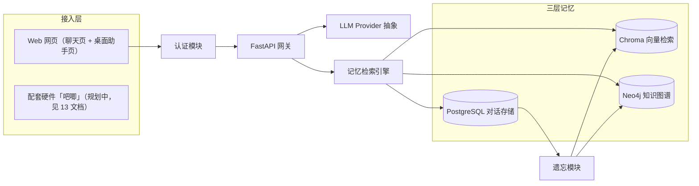

# 01_项目初始计划详解

> 相关文档：[02_长期记忆详解](02_长期记忆详解.md)（三层记忆实现）· [03_知识图谱详解](03_知识图谱详解.md)（图谱抽取/检索）· [05_前端详解](05_前端详解.md)（前端组件与 SSE）· [06_一键启动详解](06_一键启动详解.md)（容器编排/env）· [10_模型微调详解](10_模型微调详解.md)（本地微调模型）· [11_2D虚拟人物详解](11_2D虚拟人物详解.md)（虚拟形象）· [12_视觉功能详解](12_视觉功能详解.md)（视觉识别/拍照）· [13_配套硬件详解](13_配套硬件详解.md)（吧唧硬件形态）

## 1. 目标

小亦（XIAOYI）是一个**纯聊天 + 三层长期记忆**的个人 AI 助手：像人类朋友一样记住用户说过的话、认识的人、经历过的事，并在后续对话中自然调用这些记忆。它**不执行任何功能任务**，专注聊天与陪伴。

## 2. 核心功能

1. **用户认证**：手机号 + 验证码注册/登录，支持密码登录与验证码登录双模式。昵称选填。
2. **网页聊天**：SSE 流式对话，思考仅落库、前端不展示（统一 `low` 浅度思考快速回话，不做深度思考），打字机渲染。
3. **三层记忆**：
   - SQL 存储原始对话记录（工作记忆）。
   - Chroma 向量数据库存储语义可检索的记忆（语义检索）。
   - 知识图谱存储结构化的人、事、关系（长期图记忆）。
4. **记忆权重与遗忘**：常提的内容记得牢，不常提的内容逐渐淡化并归档。
5. **本地固定模型**：模型固定本地三槽位（env 写死，不接云端 API），聊天 / 记忆抽取 / 向量化分别用微调模型 / 本地千问 `qwen3:0.6b` / 本地 bge（2026-09-03 曾升 4b 强化图谱审核、09-04 因 4G 显存三方互踢降回 0.6b（台账 41 节）；09-02 曾回归 0.6b 指令模型，08-28 曾复用微调模型失败，演进见各当日台账）。
6. **语音交互**：网页语音输入 + 桌面助手实时语音对话页，本地 faster-whisper ASR + edge-tts 在线 TTS（晓晓，2026-09-03 起；TTS 为「不接云端 API」的唯一有意例外）；桌面助手配 2D Live2D 虚拟形象（四态表情 + 口型同步，见 `11_2D虚拟人物详解.md`）。
7. **数据管理**：全库导出 / 导入备份、按层清空数据（需密码）。
8. **视觉能力**：双模型级联（视觉模型看图 + 微调模型说话），支持轮询拍照（默认 2 分钟）与上传/语音触发，视觉模式开关保护隐私，照片环形存储 1000 张（见 `12_视觉功能详解.md`）。

## 3. 系统架构



> 遗忘模块 `Forgetter` → `KG` 的箭头除「摘要蒸馏」外，还包含 **图谱衰减清理**（2026-08-28 起）：非 self/bot 节点权重按天衰减、孤立低权重 Thing 节点删除，防止图谱无限膨胀（详见 03 §7 图谱遗忘）。

核心链路：`chat.py → memory_engine → llm / sql / chroma / neo4j`。`memory_engine.py` 是三层记忆的枢纽，对话、记忆检索、知识图谱抽取、遗忘都经它协调。

## 4. 模型分配（env 写死）

- 三个固定槽位：**chat**（对话，本地微调说话风格模型）/ **extract**（记忆抽取与遗忘摘要，本地千问 `qwen3:0.6b`；2026-09-03 曾升 4b 强化图谱审核、09-04 降回 0.6b，见台账 41 节；09-02 曾用 `qwen3:0.6b`，见各当日台账）/ **embedding**（向量化，本地 bge）。
- 全部 env 写死、走本地 Ollama（`XIAOYI_OLLAMA_BASE_URL`），无设置页模型库 / 功能分配界面，不接任何云端 API。训练手册见 `训练/README.md`。
- `_model_configs` 恒返回三槽位非 None 配置；`ChatModelNotConfigured` 分支保留作兜底。
- **chat 温度 0.4（2026-09-03 由 0.3 上调）**：聊天槽位固定 `temperature: 0.4`（2026-08-28 曾因 0.6B 发散降到 0.3；09-03 为跳出复读雪球上调，配 Modelfile `repeat_penalty 1.3` / `repeat_last_n 512`，详见台账 2026-09-03 二十三节）。

## 5. 核心模块

### 5.1 数据模型（`db/sql_models.py`）

- `User`：手机号、密码哈希、昵称。
- `Session`：会话（title、source=web/desktop、软删除标记 `is_deleted`），与 Message 一对多。
- `Message`：单条消息（role、content、`thinking` 思考过程、source、记忆权重 `weight`、重要性 `importance`、情感分 `emotion_score`、提及次数 `mention_count`、归档标记 `is_archived`）。

### 5.2 对话路由（`api/chat.py`）

- `POST /api/chat`：非流式（JSON），返回 `{reply, session_id}`。
- `POST /api/chat/stream`：SSE 流式，首帧回传实际 `session_id`，后续 `{delta, thinking}` 增量帧。

### 5.3 记忆引擎（`core/memory_engine.py`）

三层记忆的枢纽：`chat` / `chat_stream`（检索三层记忆 → LLM 生成 → 三存储同步持久化）、`retrieve_memory`、`clear_messages_and_sessions`。详见 `02_长期记忆详解.md`。

### 5.4 认证（`api/auth.py` + 前端 `AuthContext`）

- 手机号 + 验证码：`POST /api/auth/send_code`、`/login`、`/register`；JWT 签名，`GET /api/auth/me` 回显当前用户。
- 前端 `AuthContext`/`useAuth` 持有 token（localStorage），`api/client.js` 统一注入 `Authorization: Bearer`。
- **LLM 输出 XSS 约定**：模型输出一律按不可信文本处理，前端用 `react-markdown` 渲染（默认转义 HTML + `rehype-sanitize` 白名单消毒链接协议，`javascript:` 等危险协议被剥离），后端不在任何地方对模型输出做 HTML 拼接；聊天消息与思考内容均只落库纯文本。

### 5.5 SSE 流式契约

- 帧格式：`data: {json}\n\n`，包括 `{session_id}` 首帧、`{delta, thinking}` 增量帧、`{error, code}` 错误帧、`data: [DONE]` 收尾帧。
- 错误帧后立即关闭连接；前端错误帧后必须 `reader.cancel()` 释放连接。

### 5.6 健康检查（`api/health.py`）

- `GET /api/health`：只确认进程存活，不依赖外部存储（避免存储故障时容器被误判崩溃重启）。

## 6. LLM Provider 抽象（`core/llm_provider.py`）

统一走 OpenAI 兼容 `/chat/completions` 端点（Ollama / DeepSeek / 任意厂商均可）。全局单例 `llm`。

| 方法 | 用途 |
|---|---|
| `chat(messages, model_config, thinking)` | 非流式聊天 |
| `chat_stream(messages, model_config, thinking)` | 流式聊天，产出 `(content_delta, thinking_delta)` |
| `summarize(text, model_config)` | 对话摘要（遗忘蒸馏，02 §8） |
| `extract_triples(text, model_config)` | 抽取 (subject, predicate, object) 三元组（03 §4） |
| `extract_entities_from_text(query, model_config)` | 抽取实体名列表（图谱子图检索，03 §8） |
| `test_connection(cfg)` | 连通性测试（设置页；模型库已停用，仅兼容保留） |
| `list_models(cfg)` | 扫描可用模型列表（设置页；模型库已停用，仅兼容保留） |
| `detect_capabilities(cfg)` | 探测对话 / 向量化能力 |

关键设计：

- **宿主地址解析**：容器内把 `localhost/127.0.0.1` 自动改写为 `host.docker.internal`（`_in_docker` + `_resolve_host`），用户填本地 Ollama 地址无需感知容器。
- **快速回复优先**：聊天为第一要务，网页与桌面助手所有入口统一 `low` 浅度思考、快速回话，不做深度思考。
- **错误语义化**：ConnectError / Timeout / HTTPStatusError 统一转为面向用户的中文文案。

## 7. 后端目录树（main / dependencies / database）

```
backend/app/
├── main.py            # FastAPI 入口：CORS + 路由注册 + 启动建表 + 遗忘定时任务(asyncio 后台循环)
├── dependencies.py    # get_db：FastAPI 依赖，每请求一个 SQLAlchemy session
├── config.py          # 环境变量（DATABASE_URL / CHROMA_HOST / NEO4J_URI / JWT_SECRET 等）
├── api/               # 路由：auth / chat / sessions / settings / memory / voice / data / health
├── core/              # memory_engine（三层记忆）、llm_provider、auth、asr_provider、tts_provider、
│                      # audio_utils、forgetter、geoip 等
└── db/                # database（engine/SessionLocal/迁移）、sql_models、chroma_client、neo4j_client
```

`main.py` 启动时序：校验 `JWT_SECRET`（仅当其为非默认占位值时才告警提示——默认为开发占位仅限开发，显式配置则不告警）→ `init_db()`（建表 + 轻量迁移）→ 注册全部路由 → 启动 `_forget_loop` 后台遗忘任务（`asyncio.create_task`，间隔 `FORGET_INTERVAL_MINUTES`）。

## 8. API 路由总览

| 前缀 | 端点 | 说明 |
|---|---|---|
| `/api/health` | GET `/api/health` | 探活（免认证） |
| `/api/auth` | POST `/send_code` / `/login` / `/register`；GET `/me` | 认证 |
| `/api/chat` | POST `` / `/stream` | 非流式 / SSE 流式聊天 |
| `/api/sessions` | GET/POST ``；GET `/search`；GET `/{id}`；PUT `/{id}/title`；DELETE `/{id}`；GET `/{id}/messages`；GET `/{id}/export` | 会话 CRUD / 改名 / 软删 / 检索 / 导出 |
| `/api/settings` | GET/POST `/models`；POST `/models/scan`、`/{id}/test`；PUT/DELETE `/{id}`；GET/PUT `/function-models`；POST `/bind-phone`、`/change-password` | 模型库（env 写死后基本停用）、密码 |
| `/api/memory` | GET `/graph`；DELETE `/graph/node/{id}` | 图谱查询 / 节点删除 |
| `/api/voice` | POST `/transcribe`、`/tts` | 语音识别 / 合成 |
| `/api/data` | GET `/export`；POST `/import`、`/clear` | 全库备份 / 恢复 / 清空 |

## 9. 技术栈

- 后端：Python 3.11 + FastAPI + SQLAlchemy + SSE；PostgreSQL / ChromaDB / Neo4j 三层存储；httpx（OpenAI 兼容调用）；faster-whisper（本地 ASR）+ edge-tts（在线 TTS，2026-09-03 十八轮替换 piper，唯一云端例外）；遗忘定时任务为 asyncio 后台循环。
- 前端：React 18 + Vite + Tailwind CSS；react-force-graph（图谱可视化）、voice-activity-detection（桌面助手 VAD）。
- 编排：Docker Compose（postgres / chroma / neo4j / backend / frontend），一键启动见 `06_一键启动详解.md`。
