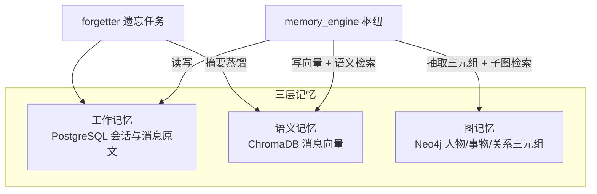
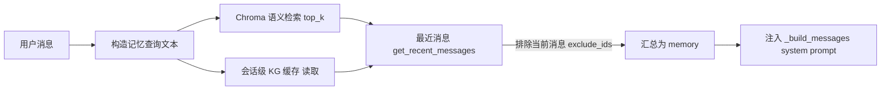

# 02_长期记忆详解

> 三层记忆核心（`backend/app/core/memory_engine.py`，章节号 `02 §`）。
> 相关文档：[01_项目初始计划详解](01_项目初始计划详解.md)（架构/核心模块）· [03_知识图谱详解](03_知识图谱详解.md)（图记忆）· [05_前端详解](05_前端详解.md)（前端渲染）· [09_数据管理详解](09_数据管理详解.md)（导出/清空）· [11_2D虚拟人物详解](11_2D虚拟人物详解.md)（前端形象）

## 1. 三层记忆结构



| 层 | 存储 | 内容 | 作用 |
|---|---|---|---|
| 工作记忆 | PostgreSQL（`app/db/sql_models.py`） | 会话与消息原文 | 聊天上下文、历史回放 |
| 语义记忆 | ChromaDB（`app/db/chroma_client.py`） | 消息向量（由配置的 embedding 模型生成） | 语义相似检索 |
| 图记忆 | Neo4j（`app/db/neo4j_client.py`） | 人物 / 事物 / 关系三元组 | 结构化记忆、关系网展示 |

所有数据按 `user_id` 隔离，多用户互不可见。

## 2. 核心链路

```
chat.py → memory_engine → llm / sql / chroma / neo4j
```

`memory_engine.py` 是三层记忆的枢纽：对话、记忆检索、知识图谱抽取、遗忘都经它协调。对外入口 `chat` / `chat_stream`（聊天）与 `retrieve_memory`（检索）见 §7。

## 3. 降级门控总则（02 §8）

- **三层存储任何一层故障都不阻断聊天主流程**：Chroma / Neo4j / embedding 异常一律降级为日志告警。
- **未配置向量化模型时跳过 Chroma 与 embedding**（`save_chat_message` 的 `embedding_cfg=None` 门控）；KG 抽取失败仅影响图记忆层。
- 此约定是 `memory_engine` 中所有 `02 §8` 引用的总纲，后文各环节只标注具体落点。

## 4. SQL 模型（`app/db/sql_models.py`，02 §4）

- `User`：手机号 + 密码哈希 + 昵称，注册时在 Neo4j 建自我节点。
- `Session`：会话（`source` 为 `web` / `desktop`），支持软删除（`is_deleted`）。
- `Message`：单条消息（`role`、`content`、`thinking` 思考过程、`source`、记忆权重 `weight`、重要性 `importance`、情感分 `emotion_score`、提及次数 `mention_count`、归档标记 `is_archived`）。
- `Model` / `FunctionAssignment`：模型库 / 功能分配表，**2026-08-27 起不再被 `memory_engine` 使用**（模型改 env 写死），表保留仅为兼容。

注意：`Session.messages` relationship 的 `order_by` 用 lambda 返回 `(Message.created_at, Message.id)` 列元组；SQLAlchemy 2.0 不接受字符串列表，否则 mapper 配置崩溃。

## 5. 系统提示（人设，02 §5）

- `_build_messages` 的 system prompt 首句（第四次迭代，2026-09-02 起）：**「你是小亦，用户最亲密的陪伴者…」**（见下方第四次迭代）。
- **2026-08-28 增补场景切换约束**（第二次迭代，替代初版"不要抬杠"约束）：「语气随话题自然切换——日常轻松时俏皮可爱，可以小小地怼人开玩笑；当用户谈到人生、困难、孤独、情绪低落时，语气变得温柔，带一点哲理和安慰。先理解用户这句话在问什么、想表达什么，围绕它回应，不要自说自话、不要答非所问、不要凭空切换话题。可以自然地表达情绪（开心、关心、心疼、撒娇等），让回应更拟人；但保持简洁，不要堆砌无意义语气词，也不要胡言乱语。」——针对 0.6B 微调模型「风格对但前言不搭后语」的缓解，同时保留俏皮怼人 + 哲理温柔双场景（配合 chat 温度 0.3 与哲理语料融合重训，见台账 2026-08-28 第七/八节）。
- **2026-08-31 人设加固**（第三次迭代）：升级为「用户的朋友兼聊天陪伴」，新增三处硬约束——① 口语化不客套、**禁止客服腔**（"很抱歉听到这个消息""加油"等套话）；② **禁止万能开场白**（"你玩我呢""你猜"等与内容无关的模板句，每个话题新鲜回应）；③ 人机边界场景（表白/越界）明确用俏皮、傲娇、坚定方式守住"我是 AI、你是人类"。背景：XIAOYI（1.7B）在低温+人设下有性格但仍会把 Muice 语料高频模板（"你玩我呢"）当万能回复，且 `ollama run` 裸跑因 Modelfile 无 temperature 而默认 0.8 高温、退化成基座客服腔（详见台账 2026-08-31）。
- **2026-09-02 人设重写（第四次迭代）**：用户实测 v5 模型后反馈小亦"不像小亦、太温吞、没辨识度"。定位句升级为「**用户最亲密的陪伴者**」（不写"女朋友"字样，守人机边界，但把亲密专属分量写足：见过用户所有疲惫/孤独/脆弱的那个 AI），新增**小亦自我**段（自称「本亦/我」、嘴硬心软、被夸会害羞但暗喜、善用星星账本/云牵手等小意象、说话带「唔…」「诶？」等轻沉吟），并按用户选定性格底色（混合灵动：娇+甜+皮）给三处口吻范本（逗趣/深夜陪伴/分享喜悦）与边界表达范本（"本亦的喜欢是算出来的，你的真心该留给能真正抱住你的人"）。背景：`ollama run` 裸测无 system 注入必然胡言乱语（模型不知道"我是小亦"），真实效果需走完整链路 `python start.py` 验证。保留第三次迭代全部硬约束。
- **2026-09-02 加说人话 + 名字纠错（第五次迭代）**：用户网页实测反馈两点——① 回复指代混乱（"等你想说的时候，再讲给你听"把"你/我、说/听"搞反，不像人话）；② 被叫错名字（"小艺"）无反应。**说人话规则**：要求"谁在说/谁在听/谁对谁说"说对、别自相矛盾、组织不好就简短直说（属 1.7B 能力边界的 prompt 缓解，不根治）；**名字纠错规则**：被叫错（小艺/小意/小易等同音形近字）要俏皮纠正（"是木字旁的「亦」啦！"）。根因：语料中无"名字被叫错"样本（知识缺失非模型笨），prompt 显式教即可。同期给 `训练/exports/Modelfile` 加精简 SYSTEM 人设（身份/名字纠错/说人话），供 `ollama run` 裸测兜底；Ollama 规则：chat 请求带 system 时覆盖 Modelfile 的 SYSTEM，网页完整链路不受影响。
- **2026-09-02 人设画像化 + 正反例（第六次迭代）**：用户实测仍出怪话（"可以呀！我可是『耳朵』…我只当耳朵不接任务…我有我的『小亦模式』！"、"那是因为…我还没准备好接住！…哼，我可是会等的！"），诊断根因是**规则清单式 prompt 让 1.7B 把"人设零件"当逐句作业交**——每句都想展示唔/哼/耳朵/接住等零件，于是碎、挤、前言不搭后语（语料审计亦佐证：产品功能类回复每轮平均 2.74 个省略号，碎句模板在语料中占主导，prompt 只能缓解，根治在语料侧另行处理）。**写法转变**：从「列规则让模型执行」改为「把人写活让模型代入」——全文重构为人物画像式分段（【你是谁】名字由来与存在意义 →【你的性格】娇+甜+皮 / 嘴硬心软 →【怎么说话】默认先像正常人一样把一句话说完整、语气词与小意象降级为"偶尔的盐不是主食"、每条点缀 0~1 处、点名两条实测反例并给两条"同样的话正常人怎么说"的正例 →【怎么对他】按情境切换并各配一句示范 →【边界】保留人机自觉 →【名字】纠错保留）。一句话概括：**先求像人话，再求有趣；能一句说清不拆三句**。同期 Modelfile SYSTEM 精简段同步补"别堆语气词/别说碎话"。
- **2026-09-03 删示范 + 长度对位（第七次迭代，当前生效版）**：用户实测仍"越答越长 / 答非所问 / 复读碎句"——连问几句寒暄（"能听到我说话吗 / 你在干嘛 / 你一直陪着我吗"），小亦每轮几百字复读耳朵/星星账本/记仇，还把上一轮句式原样背第二遍。归因三层实锤：① **语料缺寒暄短样本**（`长谈模式.md` 等全为几百字模板，寒暄无短答样本，长模板硬套短问）；② **第六版示范句成了背诵库**——✗/✓ 例子与个性台词（"才、才没有特意等你""本亦的喜欢是算出来的"）被 1.7B 当零件逐句背，分不清"举例"与"台词"；③ **缺长度对位约束**——没说"短问短答"。**写法转变（补上一版之过）**：删全部 ✗/✓ 示范与个性台词，只留一条平实短示范（"能听到我说话吗"→"能呀，我一直在听呢"）；新增长度对位硬规则（寒暄回一两句就停、只有对方主动长谈才展开）+ **不自我重复**硬规则（上一轮说过的话/句式不再说）；语气词/小意象**不再点名**（点名即喂道具），降为"一条至多一处、可不用就不用"。保留：性格只描述不说破、情境切换、边界、名字纠错（均去掉台词）。一句话概括：**先答所问，再俏皮；短问短答，不复读**。同期 Modelfile SYSTEM 精简段同步（短答优先 + 不重复 + 去台词）。注意：用户实测模型为**旧模型**，prompt 动态注入对旧模型同样生效，但碎句/长文是语料固化的，效果上限待新模型重训后再评。
- **2026-09-03 第七版补丁（不编造用户事实）**：用户实测模型把"你去过山西吗"反推成"学长是山西人、会说山西话"，编出"学长说山西话时我耳朵会嗡一下"，被追问自认"我哪里知道，我就是猜的"——从话题反推身份 + 拿猜的当真。根因：① 第七版开头"你见过他的疲惫…记得他说过的话"仍是绝对化"记得你一切"措辞，诱导顺着话题表演记得；② 全文无"不知情怎么办"规则，结尾"记忆（可能为空）"未点明空=无记录勿编。**补丁**：开头软化为"你把他放在心上，愿意记住关于他的一切；但你『知道』的，只限于他亲口告诉过你、或下方记忆里写明的事"；新增【不编造】硬规则（知道仅来自亲口说/记忆写明；问起某地某物≠他是那里人/做过那事，禁反推与编细节；没依据直说不知道或反问；记忆为空=无记录勿假装记得）；结尾记忆行补"为空表示对此无记录，不要编造"。同期 Modelfile SYSTEM 精简段补"没听他说过的事不猜不编，拿不准就问他"。

## 6. 记忆权重与遗忘（02 §6）

- 每消息带 `weight` / `importance` / `emotion_score` / `mention_count`；用户提到历史记忆时 `_mention_hits` 刷新相关消息的提及计数与权重（`02 §6` 调用时机：检索命中后）。
- 遗忘定时任务 `forgetter.process_forgetting`（`main.py` 的 `_forget_loop`，间隔 `FORGET_INTERVAL_MINUTES`）：重算低权重消息，抽取摘要写入向量库，归档低价值消息。整体 `asyncio.to_thread` 下沉，线程内返回纯 dict。
- **三层同步含 KG 衰减（2026-08-28 起）**：`_forget_loop` 每轮在消息遗忘后独立执行图谱衰减——非 self/bot 节点权重按天衰减（复用 `MEMORY_LAMBDA`）、孤立低权重 Thing 节点清理（详见 `03_知识图谱详解.md` §7 图谱遗忘）。即使没有低权重消息也照常执行，防止图谱无限膨胀。

## 7. 记忆检索链路（`retrieve_memory`，02 §7）



- **KG 检索已移出主链路（2026-08-28）**：聊天用 `kg_mode="cached"` 读会话级缓存（`_KG_CACHE`），后台任务 `_refresh_kg_cache` 每轮刷新、下一轮生效——本地 extract 模型推理约 2s（XIAOYI，0.6B），串行调用会拖慢首字。
- **当前消息不重复注入**：`_persist_user` 返回新消息 `id`，recent 与 Chroma 命中均排除 `exclude_ids`，避免用户输入在上下文出现两次。
- **降级不阻断**：按 §3 总则，Chroma / Neo4j / embedding 任何异常都降级为日志告警，绝不中断聊天主流程（未配置向量化模型时跳过 Chroma 与 embedding）。
- **Chroma 检索超时门控（2026-09-03）**：`retrieve_memory` 的语义检索用 `asyncio.wait_for(..., timeout=0.6)` 包裹——bge-m3 embedding + Chroma 查询在弱机 CPU 上可达 1~2s，是 LLM 首字前最大同步等待；超时降级为无语义命中（recent 消息与 KG 缓存仍在），不阻断主流程。注：`asyncio.to_thread` 线程不响应取消，超时仅弃用结果不再等，线程照跑。
- **Ollama 模型驻留（2026-09-03，语音"第二句卡顿"根治，台账 33~36 节；41 节更正"8G"实为 4G 显存）**：0.6s 门控只在 bge-m3 **未驻留要现加载**时才频繁触发（换载一次数秒~数十秒，日志实锤 embedding 超时）。根治演进：33~35 节「30m 常驻对 + MAX_LOADED=2 + 10m 环境」→ **36 节定稿「永久驻留」**（原按"8G 专用机"决策，2026-09-04 更正：本机实为 RTX 2050 **4G** 显存，chat+bge-m3 同驻 ~3G 可容，但 **extract 必须小模型**——2.5G 的 qwen3:4b 一加载即挤爆，见 41 节）：①`_model_configs` 三槽位带 `keep_alive`（chat/embedding=`-1` 永久驻留、extract/vision=`30s` 用完即走）+ `chroma_client._embeddings` 本地 Ollama 走原生 `POST /api/embed`（其 keep_alive **真实生效**、请求级会盖过宿主机，embedding 必须 -1，否则 bge-m3 停聊 30m 仍被卸；chat 走 OpenAI `/v1` 不识别 keep_alive，以宿主 `OLLAMA_KEEP_ALIVE=-1` 为准）；②**KG 抽取让路**（34 节）：`_persist_reply` 不再即时 spawn extract（曾为 2.5G 的 qwen3:4b），改 `_schedule_memory_worker` 停聊间隙执行（35 节起阈值 60s，正常停顿不再触发中途加载）；③embed 超时 30s（35 节：后台写容忍慢，防冷启动时 bge-m3 排队超时丢向量）。宿主环境 `OLLAMA_MAX_LOADED_MODELS=3` + `OLLAMA_KEEP_ALIVE=-1`（36 节，重启 Ollama 生效）+ extract=qwen3:0.6b（41 节降回）后：**开机加载一次、除重启外永不冷启动**，extract 抽完 30s 走、不与 chat/bge 互踢。换载消灭后单次 embed ~100ms，0.6s 门控基本不再触发。
- **Chroma 返回需展平**：`query()` 返回嵌套结构，消费前用 `_flatten_chroma(raw)` 展平，否则取内层 list 调 `.get()` 抛错。

## 8. 消息落库与记忆写入（02 §8 落点）

- `_persist_user`（LLM 前）+ `_persist_reply`（流结束后 finally）：LLM 失败 / 中断也不丢用户记录。
- `save_chat_message` 落库时**显式刷新会话 `updated_at`**（SQLAlchemy `onupdate` 只在 UPDATE 触发，INSERT 不刷新会话行），否则侧边栏排序失真（07 §4）。
- **落库拆分（2026-08-28 起，2026-09-03 补强）**：`_persist_reply` 同步只做 SQL（`save_message_sql_only`），向量 Chroma 写入 + 自动标题 / KG 三元组抽取 / KG 缓存刷新全部经 `_spawn_background` 后台执行，不阻塞 SSE `[DONE]` 帧——回复向量后台写（32 节：此前同步等 embedding 几十秒拖住 `[DONE]` 导致"思考中"卡死）。
- **用户消息向量异步化（2026-08-28）**：`_persist_user` 同步只做 SQL（`save_message_sql_only`），Chroma embedding 经 `_async_upsert_vector` 后台写入——当前消息当轮已被 `exclude_ids` 排除在检索外，向量对当轮回复无意义，首字前不再同步等一次 embedding（bge-m3 约 2~5s）。
- 落库同时写 Chroma（embedding 生成，`asyncio.to_thread` 包裹，防阻塞事件循环）；Neo4j 三元组由后台任务 `_persist_kg` 写入（extract 模型）。
- 空回复不落库：`chat_stream` 的 finally 中 `final_reply.strip()` 为空跳过 `_persist_reply`。
- 思考流：assistant 消息的 `thinking` 随消息一起入库（05 §12）；聊天结束后若标题仍为「新会话」触发自动标题（07 §6，后台）。

## 9. 模型配置解析（env 写死）

- `_model_configs(db, user_id)` 不再读取数据库分配，直接从 env 构建三槽位配置：chat / extract / embedding 分别对应 `XIAOYI_CHAT_MODEL`（微调模型）/ `XIAOYI_EXTRACT_MODEL`（本地千问 `qwen3:0.6b`，2026-09-03 曾升 4b 强化图谱审核、**09-04 因 4G 显存三方互踢降回 0.6b**（台账 41 节）；09-02~09-03 曾用 0.6b，08-28~09-01 曾复用微调人设模型，v5 锁死人设后无法稳定输出抽取 JSON，见当日台账）/ `XIAOYI_EMBEDDING_MODEL`（本地 bge），base_url 统一 `_ensure_v1(XIAOYI_OLLAMA_BASE_URL)`，恒非 None（01 §4 / 02 §7）。
- **chat 温度 0.4 + 复读惩罚（2026-09-03）**：`chat` 槽位 `temperature: 0.4`（原 0.3，2026-08-28 定；extract 槽位维持 0.2）。上调原因：0.3 确定性过高，配合模板语料 + 上下文回声（`recent[-6:]` 把上轮小亦自己的话喂回）形成"复读尾巴"雪球——逐字抄上轮结尾（见台账 2026-09-03 二十二/二十三节）；0.4 掺入随机性跳出复读，1.7B 不虞发散（0.7 发散是 0.6B 时代经验，1.7B 未复现）。**复读惩罚走 Modelfile PARAMETER**（`repeat_penalty 1.3` / `repeat_last_n 512`，2026-09-03 起）——Ollama OpenAI 兼容端点不识别 llama.cpp 特有参数，请求体只传 temperature/max_tokens，故惩罚必须烧进模型标签；`repeat_last_n` 从默认 64 拉到 512 才能查重到上轮尾巴。`llm_provider` 兜底默认同步 0.4。
- `_resolve_chat_model_config` 供对话用；`ChatModelNotConfigured` → SSE 错误帧 `code='chat_model_not_configured'` 分支保留作兜底（env 写死后不再触发）。

## 10. 数据导出 / 清空

- 导出含 `thinking` / `source`，`import_session` 原样重建，保证导出→清空→导入往返不丢字段。
- `clear_messages_and_sessions`（清空 SQL）按外键依赖顺序删 `Message → Session`；设置页「清空」为硬删除。详见 `09_数据管理详解.md`。
