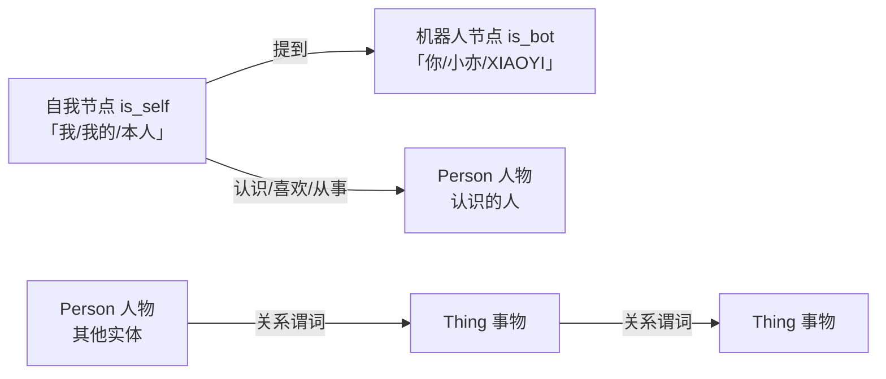

# 03_知识图谱详解

> Neo4j 图谱与 3D 关系网（`backend/app/db/neo4j_client.py` + `api/memory.py`，章节号 `03 §`）。
> 相关文档：[01_项目初始计划详解](01_项目初始计划详解.md)（架构）· [02_长期记忆详解](02_长期记忆详解.md)（检索链路）· [05_前端详解](05_前端详解.md)（Graph3D 可视化）· [09_数据管理详解](09_数据管理详解.md)（图谱导出/导入）· [11_2D虚拟人物详解](11_2D虚拟人物详解.md)（前端形象）

## 1. 图谱节点与关系



- 节点：`Person`（人物）、`Thing`（事物），带 `user_id` 属性按用户隔离（03 §7）。
- 关系：LLM 抽取的谓词（如 `认识`、`喜欢`、`从事`），经白名单正则校验后写入（Cypher 注入防护）。
- 每个用户至多一个 `is_self` 自我节点与一个 `is_bot` 机器人节点（不变量）。
- **昵称改名即更新自我节点名**：`ensure_self_node` 的 `ON MATCH SET p.name = $display` 幂等覆盖旧名，用户改昵称后再次注册/登录/打开图谱页即同步自我节点显示名，不产生第二个自我节点。

## 2. 图记忆在检索链路中的位置

```
retrieve_memory(kg_mode="cached") → 读会话级 KG 缓存 → 命中子图 facts 注入 system prompt
后台任务 _refresh_kg_cache → query_subgraph(user_id, entity_names) → 更新缓存（下一轮生效）
```

`memory_engine._memory_query` 提取用户问题中的实体名（`extract_entities_from_text`，03 §8），命中节点的一度关系子图作为结构化记忆注入对话上下文。

**聊天提速（2026-08-28 起，2026-09-03 改 lull-gate）**：KG 检索已从聊天主链路移出——`chat` / `chat_stream` 用 `kg_mode="cached"` 直接读会话级缓存 `_KG_CACHE[(user_id, session_id)]`（无缓存返回空），不再阻塞首字；缓存由后台任务刷新，**下一轮对话生效**。**2026-09-03 起刷新从"每轮回复后立即"改为"停聊间隙"**（`_schedule_memory_worker`，见 §6 调用时机）——抽取用的 extract 模型（当时 2.5G 的 qwen3:4b，**2026-09-04 已降回 0.6b**，见台账 41 节）每轮即时加载会踢掉 chat/bge-m3 交互模型导致第二句卡，故让路：会话停聊 ≥60s 才写（`_MEMORY_IDLE_SECONDS`，35 节由 15s 调高——正常停顿不再触发 qwen 中途加载），连续对话期间不打扰（34 节）。失败降级不阻断聊天（02 §8 门控）。缓存超 200 条按会话淘汰最旧（每会话保留最新 1 条），不整体清空（避免活跃会话丢记忆）。

## 3. 抽取与归并（03 §4/§5）

- **抽取**：`llm_provider.extract_triples(text)` 从对话中提取四元组 `(subject, predicate, object, objectKind)`（extract 模型，失败返回空列表）；`memory_engine` 落库时同步写入 Neo4j。`objectKind ∈ {person, thing}` 决定宾语落 Person/Thing。
- **审核式抽取（2026-09-03）**：prompt 改为「先审核、后抽取」——纯寒暄/语气词/**口误错字**（如"在妈"不得抽"妈"）/无实质内容一律返回 `[]`；谓词用中文动词（不再用 `KNOWS` 特判）；`objectKind` 由模型给出，缺失时按称谓词表（妈/爸/哥/姐/学长/朋友…）与亲缘谓词（认识/喜欢/和/跟…）启发兜底。另设 `KG_MIN_TEXT_LEN`（config.py，默认 4）：聊天文本 ≤4 字（"在吗/在妈/嗯"）直接跳过抽取，双保险防愣存。
- **去重阈值**：`KG_MERGE_THRESHOLD`（config.py）控制实体合并判定，配合 `merge_entity` 的 MERGE 幂等（按 `user_id + name` 命中即返回现有节点 id，不重复建点）。
- **跨标签同名去重（2026-09-03）**：同一名字可能在不同轮被抽成 Person / Thing 两个节点（"妈"重复根因）。`merge_person` 建节点前先查同名 Thing → 存在则 `REMOVE :Thing SET :Person` 升级复用；`merge_thing` 建节点前先查同名 Person → 存在直接返回其 id（人不降级为物）。历史存量由 `consolidate_duplicate_names` 兜底合并（打开图谱页执行，见 §9）。
- `merge_entity(name, kind, user_id)`：先判自称（`resolve_self_ref`）→ 再判机器人指代（`resolve_bot_ref`）→ 否则 `merge_person` / `merge_thing`。
- `link(from_id, rel_type, to_id, user_id)`：建关系，`rel_type` 必须通过白名单正则 `^[\u4e00-\u9fffA-Za-z0-9_]{1,32}$`（LLM 抽取的谓词拼 Cypher 的注入防护），非法类型跳过并记日志；`from==to` 自环直接跳过（3D 图渲染成环且无信息量）。
- `_SELF_REFS = ("我", "我自己", "本人", "自己", "我的")`。

## 4. 自我节点与机器人节点（03 §6）

- **自我节点**（`ensure_self_node`，幂等）：注册 / 登录时兜底创建，名称=昵称（无昵称则「用户+手机号」）。对话中「我 / 我的 / 本人」等自称指代归并到自我节点。
- **手机号脱敏**：无昵称时自我节点显示名用**脱敏手机号**（`用户+{前 3 位}****{后 4 位}`，如「用户+138****1234」），**不以明文手机号入库**；完整手机号仅存 PostgreSQL `User.phone`（登录用），不出现在图谱。
- **机器人节点**（`ensure_bot_node`，幂等）：对话中「你 / 小亦 / XIAOYI」指代聊天机器人，归并到 `is_bot` 节点，避免图谱出现孤立的「你」节点。

```python
# neo4j_client.py 顶部常量（小亦品牌）
_BOT_REFS = ("你", "小亦", "xiaoyi", "XIAOYI")
_BOT_DISPLAY = "小亦"
```

- `consolidate_self_refs` / `consolidate_bot_refs`：打开图谱页兜底执行，把历史孤立的「我 / 你」节点的关系转移到自我 / 机器人节点后删除，幂等、失败不阻断（03 §6 扩展）。

## 5. 多用户隔离（03 §7）

- 所有节点与关系带 `user_id` 属性，所有 Cypher 查询都带 `user_id: $user_id` 过滤，多用户互不可见。
- 关系建边（`link`）额外校验 `a.user_id = $user_id AND b.user_id = $user_id`，杜绝跨用户关联。
- 节点删除（`delete_or_archive`）同样限定 `n.user_id = $user_id`。

## 6. 子图检索（03 §8）

- `query_subgraph(user_id, entity_names, depth=1, directed=True)`：按实体名（含 aliases 别名匹配）查一度（可配多度）子图，`LIMIT 50`；供 `retrieve_memory` 后台刷新 KG 缓存使用。
- 实体名来源：`llm_provider.extract_entities_from_text`（从用户问题抽取，最多 5 个，失败返回空列表）。
- **实体抽取失败跳过检索**（2026-08-28）：抽取失败/返回空时 `retrieve_memory` 直接跳过 KG 子图查询（不把整句作为实体名去查询/建节点），避免整句污染图谱；同时记录日志供排查。
- 子图以 Cypher `path` 返回，`_format_kg_facts` 展平后注入 system prompt（02 §7）。
- **调用时机（2026-08-28 起，2026-09-03 改 lull-gate）**：聊天主链路不再实时调用（避免本地 extract 模型推理拖慢首字），改由后台 `_refresh_kg_cache` 刷新会话级缓存、下一轮检索读取。**2026-09-03 起写入时机改为"停聊间隙"**：`_persist_reply` 不再每轮回复结束立即 spawn 抽取（当时的 qwen3:4b(2.5G) 即时加载会踢掉 chat/bge-m3 交互模型、占住 Ollama 队列，导致用户第二句卡顿；**09-04 extract 已降回 0.6b，但 lull-gate 保留**，见台账 41 节），改经 `_schedule_memory_worker` 排队——worker 等到该会话停聊 ≥60s（`_MEMORY_IDLE_SECONDS`，35 节由 15s 调高）才执行 `_persist_kg` + `_refresh_kg_cache`；连续对话期间持续让路，上限 5 分钟兜底；快速连说多轮 coalesce 只抽最新一轮（台账 34 节）。

## 7. 全图查询与节点删除（03 §9）

- `get_full_graph(user_id, edge_limit=500)`：返回全图供 3D 渲染，**必须含孤立节点**（含自我节点），否则新用户图谱为空。`LIMIT` 作用于返回行，限制的是关系条数。
- **截断提示**：返回 `truncated: true` 表示关系数达到 `edge_limit`（500），实际关系可能更多——前端 3D 图谱页据此展示「仅显示前 N 条关系」提示（03 §9 扩展）。
- `DELETE /api/memory/graph/node/{node_id}`：级联删除节点及其关联边（仅限当前用户）。
- 查询前兜底 `ensure_self_node` + `consolidate_bot_refs`，保证任何账号打开图谱页至少有自我节点、无孤立「你」。

### 图谱遗忘（衰减 + 清理，03 §9 新增）

- **动机**：图谱是「只增不减」的，长期对话节点/关系无限膨胀，3D 图越来越乱、检索噪声增加。随遗忘定时任务（`FORGET_INTERVAL_MINUTES`，02 §6）同步引入衰减清理。
- **衰减**（`neo4j_client.decay_kg`）：所有非 `is_self` / `is_bot` 节点的 `weight` 按天指数衰减（复用 SQL 的 `MEMORY_LAMBDA`，`weight *= exp(-MEMORY_LAMBDA * days)`）；建节点时初始 `weight=0.5`、`last_mentioned_at=now`。
- **提及增强**（`query_subgraph`）：子图检索命中实体会刷新 `last_mentioned_at` 并 `weight += 0.1`，常被聊到的实体权重回升、不会被误清。
- **清理**：权重低于 `ARCHIVE_THRESHOLD`（0.25）**且无任何关系（孤立 Thing）** 的节点 `DETACH DELETE`；单轮最多清理 100 条防抖动。`is_self` / `is_bot` 及仍有关系的节点永不清理。
- **调度**：`_forget_loop` 每轮消息遗忘后独立执行图谱衰减（对全部有图谱数据的用户），无低权重消息时也照常衰减。

### 会话相关节点清理（07 §7 对应）

- 节点可带 `session_id` 属性（当前仅事件类节点使用；Person / Thing 实体节点不带）。会话删除时由 `neo4j_client.delete_or_soft_delete_session_refs(user_id, session_id)` 按 `n.session_id = $session_id` 匹配并 `DETACH DELETE`，限定当前用户。
- 该逻辑幂等：无匹配节点时为空操作；失败不阻断会话删除主流程。

## 8. Neo4j 使用要点

- **取节点 id 必须用 `elementId(x)` 函数**：Cypher 查询字符串里 `x.element_id`（属性语法）返回 NULL 并告警，导致边建不出来、关系网只有节点没有边。凡 Cypher 内取 id 一律 `RETURN elementId(x) AS id` / `WHERE elementId(x) = $id`；仅 Python 驱动对象属性 `rec["n"].element_id` 保持原样。
- `import_graph` 幂等：导入前先 `clear_graph(user_id)`（备份恢复=整体替换），节点剥离 `is_self` / `is_bot` 特殊属性（由兜底方法重建），防重复导入复制不变量节点。
- 数据库密码默认 `xiaoyi_pass`（`.env` 的 `NEO4J_PASSWORD`，compose 内 `NEO4J_AUTH`）。

## 9. 前端 3D 关系网

- `Graph3D.jsx` 由 `react-force-graph-3d` 渲染；`Graph.jsx` 顶层 `absolute inset-0` + `ResizeObserver` 量容器尺寸。背景统一为星夜（2026-09-03 十二轮）：画布 `backgroundColor="rgba(0,0,0,0)"` 全透明 + 容器无实色，透出 App 根节点 `.starry-sky`（CSS 星点星云），与其余三页一致（早期实色 `#0a0f2c` 已弃用）。
- **静态星图布局（2026-09-03，十四轮定型）**：全节点**预固定**——`graphData` 预处理里对每个节点设 `fx/fy/fz = x/y/z`。中心(is_self)固定原点；普通节点按度数分层放在 fibonacci 均匀球壳上（方向确定性不闪跳，半径 `r = clamp(70 - √deg·8, 45, 70)`，中心光晕视觉半径仅 ~8 远小于 45）→ 固定节点不被任何 d3 力移动，天然不叠中心、不塌缩、无收敛依赖；节点可拖拽（DragControls 对固定节点有效，拖拽期改 fx、松手停原处）。相机固定 `cameraPosition({x:0,y:0,z:150})` + `camera().lookAt(0,0,0)`（ref effect，只动相机）。空图 gate：nodes=0 不挂载引擎（显示空态文案）。**渲染崩溃史（重要教训）**：十轮起在 force 干预 effect 里调 `fg.d3Force('center', null)` + `d3ReheatSimulation()` 想防贴脸——但 three-forcegraph 的 `d3ReheatSimulation → resetCountdown` 会**无条件 `engineRunning=true`**，而 `state.layout` 由 kapsule 的 1ms debounce 在 mount 后**异步**建立；layout 建好前首个动画帧 `tickFrame → state.layout.tick()` 抛 `TypeError: Cannot read properties of undefined (reading 'tick')`，且异常发生在 `_animationCycle` 内使下一次 rAF 不再调度 → **渲染循环永久死亡**（数据再全也不显示）。十/十一/十三轮都调了它所以全部同症状崩溃（换改哪些力都无效）；九轮没调所以正常。另十三轮还修了星石动画 rAF 误调 `fgRef.graphData()`（不在 methodNames、每帧 TypeError）。终局方案 = 彻底不碰引擎内部状态（删 force 干预），防贴脸改全节点预固定；Graph3D 内置 + Graph 页 `GraphBoundary` 错误边界兜底。
- **双人中心合成（2026-09-03）**：图谱只记录"小亦 + 用户"共同发生的事，`Graph.jsx` 拉取后由 `composeDuoCenter` 在展示层把 `is_self`（如"星辰学长"）与 `is_bot`（小亦）合成一个中心节点——昵称省去前缀后并名（"星辰学长"→简称"学长"），中心名即**「学长与小亦」**；bot 节点移除、其关系并入 self（合并后自环丢弃）。**仅改前端展示数据**，后端 `is_self`/`is_bot` 不变量与记忆检索链路不受影响，NodeDetail/删除零风险。
- **3D 星石节点（2026-09-03，05 §8）**：普通节点 = 3D 尖芒多角「星石」——UV 球顶点沿 12 个 fibonacci 均匀芒向做幂次外推（`r = 1 + 0.55·Σ max(0,d·s_k)^8`）形成满球尖芒，几何模块级共享缓存、各节点独立糖果色 `MeshPhongMaterial`（`emissive` 同色自发光），外挂加法混合柔光 `Sprite`（颜色=糖果色）→ 立体多角、Q 版闪亮。颜色按 `node.label` 字符串哈希映射 10 色糖果色板，同类型恒同色、不同类型异色。星石整体 `scale` 按关联度（度数）映射 [1.0, 1.9]。
- **中心「学长与小亦」**：明亮 3D 发光球——亮粉 `MeshPhongMaterial`（`color 0xffc4ec` + 高 `emissive 0xa85cf0`）+ 加法柔光大 `Sprite` + 半透明加法 halo，固定原点、明显大于普通星石（主次分明）。
- **rAF 动画**：`nodeThreeObject` 返回自定义对象后，three-forcegraph 不再自动缩放/着色/调透明度，全由本组件自理。rAF 每帧让星石自转（`rotation.y/x` 慢速叠加，显 3D 立体感）、星石辉光（加法 Sprite `opacity` 与 `emissiveIntensity`）按各节点随机相位/速度正弦脉动 → 群星「布灵布灵」错落闪光；中心球做轻呼吸脉动。只动 rotation/material，不与 hover 缩放冲突（hover 放大 1.5 倍基于对象记录的 `defScale` 还原）。
- 边为静态细线（`linkColor=rgba(124,108,255,0.55)`），无箭头/流动粒子；`linkLabel` 悬停显示关系类型。
- `GET /api/memory/graph` 打开图谱页兜底执行 `ensure_self_node` + **`ensure_bot_node`**（2026-09-03 十四轮：保证新账号即使没聊过天也有 is_bot 节点，前端 `composeDuoCenter` 才能合成「学长与小亦」中心）+ `consolidate_self_refs` + `consolidate_bot_refs` + **`consolidate_duplicate_names`**（跨标签同名合并，03 §3），幂等、失败不阻断 → 历史"妈[Person]+妈[Thing]"类重复在下次打开自动归并为一个。
- 空图谱提示文案：「图谱还没有节点，先和小亦聊几句吧」。
