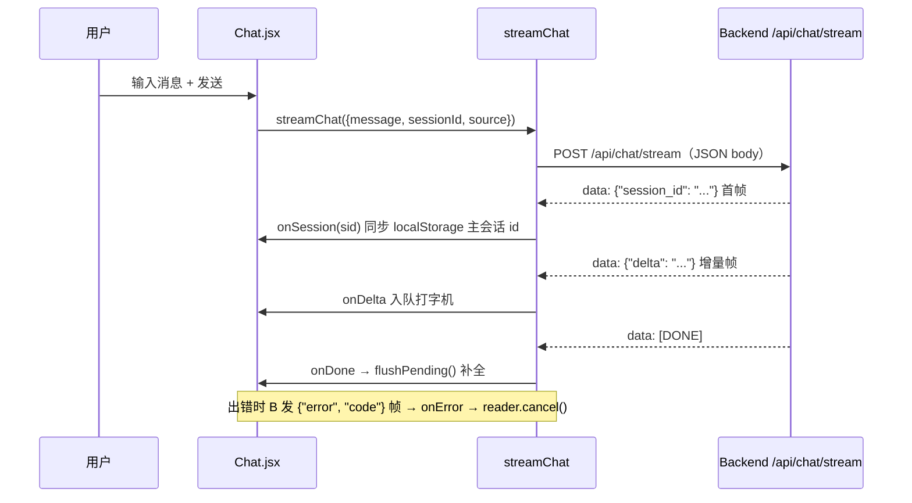

# 05_前端详解

> React 前端（`frontend/`，章节号 `05 §`）。React 18 + Vite 5 + Tailwind CSS，品牌「小亦」英文 XIAOYI。
> 相关文档：[01_项目初始计划详解](01_项目初始计划详解.md)（架构/SSE 契约）· [03_知识图谱详解](03_知识图谱详解.md)（Graph3D）· [04_语音输入与识别详解](04_语音输入与识别详解.md)（VoiceRecorder）· [08_桌面助手详解](08_桌面助手详解.md)（DesktopAssistant）· [11_2D虚拟人物详解](11_2D虚拟人物详解.md)（VirtualAvatar）

## 1. 页面与路由（`src/App.jsx`）

| 路由 | 页面 | 说明 |
|---|---|---|
| `/` | `pages/Chat.jsx` | 聊天页（沉浸式单会话：Q 版形象 + 消息区 + 输入框） |
| `/graph` | `pages/Graph.jsx` | 3D 关系网 |
| `/desktop` | `pages/DesktopAssistant.jsx` | 桌面助手实时语音对话 |
| `/settings` | `pages/Settings.jsx` | 设置页（模型配置说明 / 账号绑定 / 数据管理） |
| `/login` `/register` | `Login.jsx` / `Register.jsx` | 登录 / 注册 |

`AuthRoute` 包裹需登录页面；登录成功后必须 `useAuth().login(token, user)` 更新全局 user（不能只写 localStorage）。登录后 `AppLayout` 渲染 **双轨导航**（2026-09-03）：桌面（`md+`，≥768px）= 顶部 `Navbar`（玻璃胶囊导航，当前页高亮）；移动（`<md`）= 极简顶栏（品牌 + 设置/退出图标，`Navbar` 内）+ **底部 `MobileTabBar`**。全局容器挂 `starry-sky` 星夜背景（`App.jsx`），`h-screen flex-col`：移动端 `main` 之上是极简顶栏、之下是底栏（flex 不叠内容，无需遮挡补偿）。

**导航星象名**（2026-09-03）：4 主入口按小亦"星空/收集星系"人设起名——`/` 星语（文字聊天）、`/desktop` 星伴（桌面语音陪伴）、`/gallery` 拾光（视觉照片墙）、`/graph` 星图（记忆/人际图谱，图标为四角星 sparkle）。桌面/移动命名与顺序一致；「设置」不入导航区，桌面为顶栏右侧齿轮按钮、移动为顶栏齿轮。

## 2. 组件清单（`src/components/`）

| 组件 | 职责 |
|---|---|
| `ChatInput.jsx` | 文字输入 + 语音按钮（`VoiceRecorder`）；Enter 发送须 `!e.nativeEvent.isComposing && e.keyCode !== 229`（中文选词不误发），`sendingRef` 防双击重复提交；录音中点发送 = 关麦 + 发送。**附件收窄为仅图片**（12 §2）：`ACCEPT='image/*'`，已选图片缩略图预览（objectURL，发送/移除时 revoke） |
| `ChatMessage.jsx` | 消息气泡（用户 / 助手），`streaming` 空内容时显示「思考中…」（三点星光呼吸占位） |
| `Markdown.jsx` | 最终回复经 react-markdown + remark-gfm 渲染（用户看不到原始 Markdown 符号）；**模型输出按不可信文本处理**：react-markdown 默认转义原始 HTML + `rehype-sanitize` 白名单链接协议（`javascript:` 等被剥离），杜绝 LLM 注入脚本 |
| `Graph3D.jsx` | 3D 关系网（详见 `03_知识图谱详解.md`） |
| `NodeDetail.jsx` | 图谱节点详情弹窗（属性查看 + 节点删除） |
| `DeleteConfirm.jsx` | 通用确认删除弹窗（图谱节点 / 清空数据用） |
| `VoiceRecorder.jsx` | 语音输入（详见 `04_语音输入与识别详解.md`） |
| `VirtualAvatar.jsx` | 2D Live2D 虚拟形象（待机/倾听/思考/说话四态专属动作 + TTS 口型同步，`size`/`fill` prop 控制，详见 `11_2D虚拟人物详解.md`） |
| `Navbar.jsx` | **双轨导航**：桌面（`hidden md:flex`）顶部品牌 + 4 主入口胶囊 + 昵称/设置齿轮/退出；移动（`md:hidden`）极简顶栏（品牌 + 设置齿轮/退出图标）。4 主入口星象名：星语/星伴/拾光/星图（2026-09-03） |
| `MobileTabBar.jsx` | 移动端底部导航（`md:hidden`，2026-09-03 起）：星语 `/` · 星伴 `/desktop` · 拾光 `/gallery` · 星图 `/graph`，active 高亮玻璃胶囊 + 内联 SVG 图标（星图为四角星 sparkle） |
| `AuthRoute.jsx` | 路由守卫：未登录跳 `/login` |
| `AuthContext.jsx` / `hooks/useAuth.js` | 全局登录态（token + user，localStorage 持久化） |

辅助：

- `src/api/`：`client.js`（fetch 封装 + Bearer 注入 + 401 跳登录）、`auth.js`、`chat.js`（`streamChat`）、`sessions.js`、`settings.js`、`memory.js`、`voice.js`。
- `src/utils/`：`text.js`（`stripMarkdown`，TTS 前 Markdown→纯文本，04 §9）、`audio.js`（`blobToWav16k`，04 §3）。
- `src/hooks/useModelStatus.js`：模型固定 env 配置后不再请求分配接口，直接返回恒真配置。

## 3. SSE 流式对话（`src/api/chat.js` 的 `streamChat`）

- `POST /api/chat/stream` 为 JSON body（message / session_id / source），返回 AbortController。
- SSE 帧：`{session_id}` 首帧 → `{delta}` 增量帧 → `{error, code}` 错误帧 → `data: [DONE]`。（后端仍透传 `{thinking}` 增量帧用于 `Message.thinking` 落库，前端不再消费展示）
- 回调：`onSession` / `onDelta` / `onError` / `onDone`。
- 错误帧后必须 `reader.cancel()` 释放连接；离开页面时 `abortRef.current?.abort()`（单会话模式下无"切会话"中止）。

## 4. 打字机渲染（`pages/Chat.jsx`）

- delta 先入队（`pendingRef`），30ms 定时器逐字 reveal（每 tick ~3 字符）。
- 流结束时 `flushPending()` 一次性补全并 `patchAssistant({content})` 写回 state——否则单帧整段回复渲染成空白气泡。
- 离开页面 / 懒创建主会话的 sessionId 变更时必须 `clearReveal()` 清空队列与定时器（`noAbortRef` 放行懒创建那一轮，防中断在途 SSE）。
- **不采集思考（2026-08-28 起）**：前端 `onThinking` 为空实现，`ThinkingBlock.jsx` 已移除；assistant 气泡流式占位统一为「思考中…」。

## 5. 会话恢复（单会话模式，2026-09-03 起）

- **沉浸式单会话**：web 聊天永远落在同一条**主会话**，不再有会话列表 / 新建 / 切换 / 删除 UI（旧会话数据保留在数据库，仅前端不展示）。
- 主会话 id 持久化：**localStorage**（key=`xiaoyi_main_session_{user.id}`，按用户隔离），跨浏览器重启仍恢复同一会话；无记录时进入欢迎态，由首次发送消息懒创建（`ensureMainSession` 防双开会话）。
- `onSession` 首帧回调只同步 `sessionIdRef` + localStorage，**不 setSessionId**（否则触发 abort effect 中断在途 SSE 流）。
- 主会话在库里失效（如被清空数据硬删）→ 加载失败时清 localStorage 回欢迎态，下次发送自动重建。

## 6. 消息拉取竞态防护

加载会话消息用 `loadSeqRef` 请求序号，响应返回时 `seq !== loadSeqRef.current` 则丢弃（快速切会话时旧响应不覆盖新消息）。

## 7. 模型状态 hook（`src/hooks/useModelStatus.js`）

模型固定 env 配置后，hook 不再请求 `GET /api/settings/function-models`，直接返回恒真配置（`chat_configured` / `extract_configured` / `embedding_configured` 均为 true）——聊天 / 关系网 / 桌面助手页的「未配置对话模型」引导 banner 因此不再出现。

## 8. UI 风格（Q 版星夜主题，2026-09-03 起）

- 主题：**星空深蓝紫 + 粉紫点缀**（贴合"星星账本"意象）。配色板定义在 `tailwind.config.js`（night 夜空底 / nebula 星紫主色 / blush 粉彩高亮 / stardust 浅色文字层级），公共类 `.input-base` / `.btn-primary` / `.btn-secondary` / `.glass` / `.starry-sky` 在 `src/index.css`；动画：`animate-twinkle`（星光呼吸）/ `animate-floaty`（形象轻浮）/ `animate-breathe` / `animate-pop-in`（气泡进场）。
- 全局星空背景挂在 `App.jsx` 容器（`.starry-sky`），页面用透明 + 毛玻璃卡片；深色主题下旧 slate/indigo 工具色已全部替换（Markdown 渲染 / 图谱 3D 背景同步调暗为 `#0a0f2c`）。
- **四页背景统一为星夜（2026-09-03 十二轮）**：星语/星伴/拾光/星图四页背景一致——均透出 App 根节点 `.starry-sky`（CSS radial-gradient 星点 + 星云光晕）。星图页实现：容器去掉实色 `bg-night-900`，WebGL 画布 `backgroundColor="rgba(0,0,0,0)"` 全透明（three-render-objects 渲染器默认 `alpha:true`，`setClearColor(色, alpha=0)` 透出下层 CSS 星夜；`onReady` 里 `renderer().setClearColor(0x000000,0)` 兜底）。
- **星图星石 + 双人中心**（2026-09-03）：星图页普通节点 = 3D 尖芒多角「星石」（糖果色自发光、加法光晕、rAF 自转 + 错落闪烁）；中心节点在展示层由 `composeDuoCenter` 把自我节点与小亦节点合成「学长与小亦」（昵称前缀省略）的明亮 3D 发光球（视觉与实现详见 `03_知识图谱详解.md` §9）。
- **星图交互：名字常驻 + 中心锁死 + 拖拽弹回**（2026-09-03 十五轮）：`Graph3D.jsx` 节点改双层 Object3D——外层 outer 负责定位/拖拽/弹回（不缩放），内层 inner 承载星体按度数缩放（hover 只放大 inner）。**名字常驻**每个节点下方（canvas billboard Sprite，白色星紫夜光细闪小字，静止半透明、hover 提亮到 1；手机不点也看得到名字）；**中心锁死**：「学长与小亦」整棵子树 `raycast` 置空 → 拖拽/悬停/点击全部绕开它，永远钉在屏幕最中心（原点）；**卫星拖拽弹回**：松手沿当前方位 0.32s easeOutCubic 弹回原轨道半径（永不塌进中心）。节点库默认气泡显式置空（`nodeLabel={() => ''}`），连线悬停「关系：xxx」气泡改星紫玻璃胶囊（`#root .graph3d-shell .float-tooltip-kap`，`index.css`）。
- **素材目录 `frontend/public/avatars/`**：聊天页欢迎态 C 位头像与陪伴角头像引用 `xiaoyi.png`；正式形象替换同名文件即可（代码零改动）。占位图为公有领域素材，来源与替换规格见同目录 `来源.txt`。
- 桌面助手仍用 Live2D（`VirtualAvatar`，见 11 文档），页面皮肤与聊天页统一星夜玻璃风。
