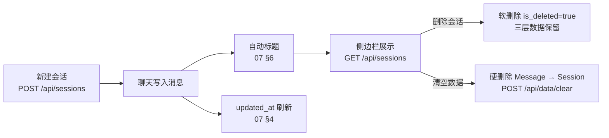

# 07_会话历史记录详解

> 会话与历史（章节号 `07 §`，路由见 `backend/app/api/sessions.py`，模型见 `app/db/sql_models.py`）。会话 = `Session`（SQL），消息 = `Message`（SQL）；后端保持多会话 API，web 前端 2026-09-03 起改为**单会话模式**（见 §9）。
> 相关文档：[01_项目初始计划详解](01_项目初始计划详解.md)（API 总览）· [02_长期记忆详解](02_长期记忆详解.md)（消息落库）· [05_前端详解](05_前端详解.md)（沉浸式单会话/皮肤）· [09_数据管理详解](09_数据管理详解.md)（导出/清空）· [11_2D虚拟人物详解](11_2D虚拟人物详解.md)（桌面会话页）

## 1. 会话生命周期

- **创建 → 聊天 → 自动标题 → 侧边栏展示**：正常生命周期。
- **软删除**（侧边栏「删除会话」）：`is_deleted=true`，数据保留可恢复，供记忆引擎继续引用，不参与列表展示。
- **硬删除**（设置页「清空数据」）：按外键依赖顺序删除 `Message → Session`，需密码。

## 2. 会话数据模型（07 §4）

- `Session`：`user_id`、`title`（自动标题）、`source`（`web` / `desktop`）、`is_deleted` 软删除标记、`created_at` / `updated_at`。
- `Message`：`session_id` FK、`role`、`content`、`thinking`、`source`、`weight` / `importance` / `emotion_score` / `mention_count`、`is_archived`。
- 同一用户不同 source（聊天页 vs 桌面助手）各有独立会话列表。
- `Session.messages` 排序 `(created_at, id)` 稳定；新消息落库后显式刷新会话 `updated_at`（SQLAlchemy `onupdate` 只在 UPDATE 触发，INSERT 不刷新会话行），否则侧边栏按活跃度排序失真（02 §8 落点）。

## 3. 会话路由（07 §5~§10，`api/sessions.py`）

**路由顺序约定（07 §5）**：`/search` 必须定义在 `/{session_id}` 之前，否则被路径参数吞掉。

| 端点 | 说明 |
|---|---|
| `GET /api/sessions` | 列表，分页，只返回**非软删除**会话，按 `updated_at` 降序 |
| `POST /api/sessions` | 新建（body 可带 `source`，默认 web） |
| `GET /api/sessions/search?q=` | 按消息内容 / 标题模糊搜索，返回会话列表 |
| `GET /api/sessions/{id}` | 详情（含全部消息） |
| `PUT /api/sessions/{id}/title` | 手动改名 |
| `DELETE /api/sessions/{id}` | 软删除 |
| `GET /api/sessions/{id}/messages` | 会话内消息分页（`created_at, id` 稳定排序） |
| `GET /api/sessions/{id}/export` | 导出 markdown / json |

## 4. 自动标题（07 §6）

- 聊天结束在 `memory_engine` 内触发（`_apply_title`）：幂等，**仅当标题仍为「新会话」才更新**，生成成功后不再重复触发。
- `chat_cfg` 非空且会话标题仍为「新会话」时触发自动标题；生成失败不阻断主流程。
- 会话消息数达到阈值后，用模型生成简短标题（07 §6）。

## 5. 会话详情与消息分页

- `GET /api/sessions/{id}` 返回会话全部消息（含 `thinking`）。
- `GET /api/sessions/{id}/messages` 支持分页（page_size ≤200），排序 `Message.created_at, Message.id` 保证同秒多消息稳定返回。
- 两者均只返回**非软删除**会话；不存在返回 404。

## 6. 会话恢复（前端，07 §7）

- 单会话模式（2026-09-03 起，web 聊天页）改为主会话 localStorage 持久化，详见 §9；本节描述的多会话 sessionStorage + URL 恢复逻辑已随侧边栏一起下线。
- 桌面助手（`source=desktop`）仍用自己的独立会话（`desktop_session_id_{user.id}`），与 web 主会话互不干扰。
- 切会话拉消息用 `loadSeqRef` 请求序号防竞态（旧响应 seq 不匹配即丢弃）。

## 7. 软删除 vs 硬删除

- **删除会话**（侧边栏）＝软删除 `is_deleted=true`：数据保留供记忆引擎继续引用，不参与列表展示；**无恢复入口（API 与 UI 均未提供撤销/恢复）**。
- **清空数据**（设置页数据管理）＝硬删除，`clear_messages_and_sessions` 按外键依赖顺序删除 `Message → Session`；清空后侧边栏只留一条「新会话」。
- 会话删除时级联清理会话相关事件引用（`neo4j_client.delete_or_soft_delete_session_refs`，删除带 `session_id` 属性的节点；见 `03_知识图谱详解.md` 对应清理说明）；统一日志见 `app/core/logger.py`（见 `02_长期记忆详解.md` §6 引用）。

## 8. 历史导出 / 导入

- 导出 / 导入保留 `thinking` / `source` 字段，`import_session` 原样重建，保证「导出 → 清空 → 导入」往返不丢字段。详见 `09_数据管理详解.md`。

## 9. 单会话模式（web 前端，2026-09-03 起）

> 设计取舍：网页聊天页改成陪伴 APP 式沉浸界面后，不再提供会话列表 / 新建 / 切换 / 删除 UI——打开即同一条**主会话**，历史永久累积。后端多会话 API 全部保留，仅前端收敛入口。

- **主会话 id**：localStorage（key=`xiaoyi_main_session_{user.id}`，按用户隔离），跨浏览器重启仍恢复；无记录 → 欢迎态，首次发送消息时懒创建（`Chat.jsx` 的 `ensureMainSession` 用 in-flight Promise 防双开会话竞态）。
- **onSession 自愈**：后端返回的新 session_id 只同步 `sessionIdRef` + localStorage，不 setSessionId，避免触发 abort effect 中断在途 SSE（05 §3/§4）。
- **主会话失效**（如设置页硬清空数据）：`GET /api/sessions/{id}` 404 → 前端清 localStorage 回欢迎态，下次发送自动重建。
- **旧会话数据**：保留在数据库不动（记忆检索仍可引用），仅前端不再展示切换入口。
- **桌面助手**：`source=desktop` 独立会话不受影响。
