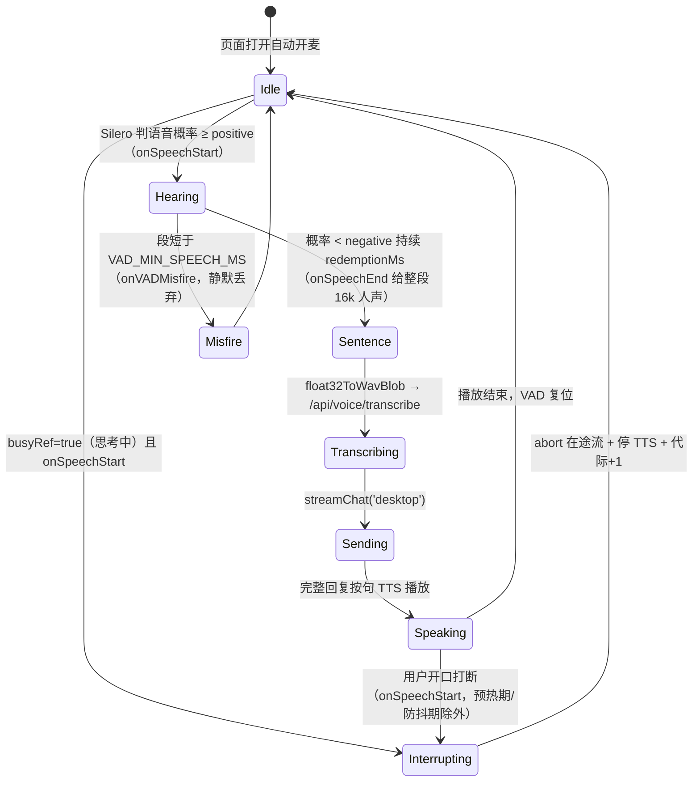
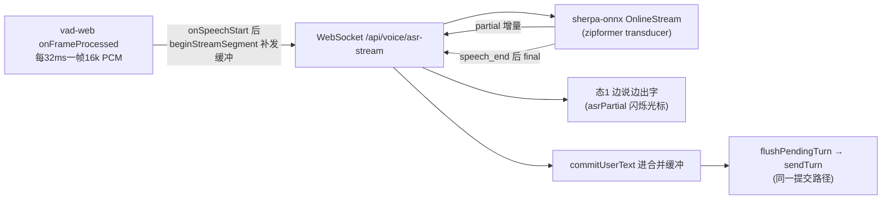
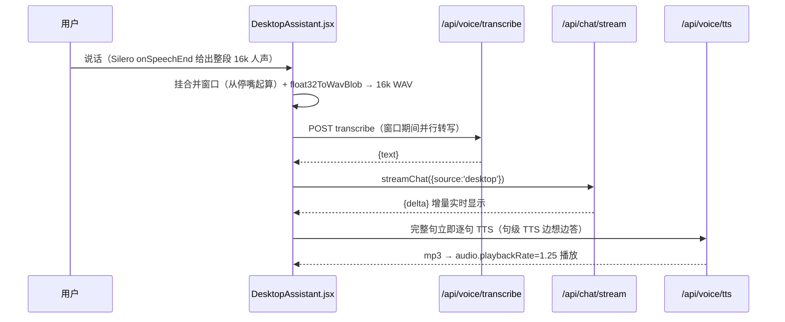

# 08_桌面助手详解

> 桌面助手实时语音对话页 `/desktop`（`frontend/src/pages/DesktopAssistant.jsx`，章节号 `08 §`）。
> 相关文档：[04_语音输入与识别详解](04_语音输入与识别详解.md)（ASR/TTS 链路）· [05_前端详解](05_前端详解.md)（ChatMessage 复用）· [07_会话历史记录详解](07_会话历史记录详解.md)（会话隔离）· [11_2D虚拟人物详解](11_2D虚拟人物详解.md)（虚拟形象）· [12_视觉功能详解](12_视觉功能详解.md)（摄像头/背景）

## 1. 定位

仿「桌面语音助手」的沉浸式实时对话：打开页面即自动开麦监听、离开自动停麦，说话即达、回话即播，无需点击。与聊天页共用同一套 `memory_engine`（会话/记忆隔离独立会话列表，`source='desktop'`）。

## 2. 关键参数

```js
// ---- Silero VAD（@ricky0123/vad-web v5，浏览器本地 ONNX 推理，2026-09-03 起）----
// 资产目录带版本号 /vad2/：URL 换版本即整体换新，绕开浏览器对旧 URL 的错误 MIME 缓存（见 §3 ③）
const VAD_BASE_PATH = '/vad2/';       // silero_vad_v5.onnx + vad.worklet.bundle.min.js（npm postinstall 拷入 public/vad2）
const VAD_ORT_PATH = '/vad2/ort/';    // onnxruntime-web 的 *.wasm + *.mjs（.mjs 为运行时动态 import 的加载胶水，须与 wasm 同目录）
const VAD_POSITIVE_THRESHOLD = 0.6;   // 语音概率超此值计为语音帧（默认 0.3 过灵敏，嘈杂环境易误报）
const VAD_NEGATIVE_THRESHOLD = 0.35;  // 概率低于此值计为非语音帧（须 < positive）
const VAD_REDEMPTION_MS = 400;        // 语尾停顿多久判定"说完了"（默认 1400 太长，拖慢收尾）
const VAD_PRE_SPEECH_PAD_MS = 300;    // 段前回补（不丢用户开口）
const VAD_MIN_SPEECH_MS = 300;        // 段短于此值丢弃（防噪声段误转写）
const VAD_SPEAK_WARMUP_MS = 300;      // TTS 每句起播预热期（回声兜底）
const LAST_INTERRUPT_MS = 500;        // 打断防抖（防 TTS 尾音回声连环自打断）
const MERGE_WINDOW_MS = 1000;     // 用户停止说话后等待合并窗口（2026-09-03 由 2.5s→1.8s→1.2s→0.4s→0.8s→1.0s：0.4s/0.8s 实测把正常换气、意群停顿误判"说完"导致一句拆多段回复；VAD 段切碎不丢字——段转写只追加进缓冲，真正影响"拆不拆轮"的只有此窗口。1.0s：停顿>1s 后接话 = 打断重答，两句连续发（见 §4.5）。2026-09-03 首响提速后窗口在"停嘴"即挂、与转写并行（见 §4 ①），转写完成不再重挂，只有真正静默到点才 flush）
const MAX_PENDING_LEN = 500;      // 单段输入最大长度，超长截断（取前 500 字，防止把整段朗读/环境声喂给模型）
```

参数为初值保守档（防误报优先）；实测后回填：噪声仍误触发 → 上调 `VAD_POSITIVE_THRESHOLD`；说话不识别/句子被切碎 → 下调 positive、上调 `VAD_REDEMPTION_MS`。

## 3. 语音监听与打断（Silero VAD 状态机，2026-09-03 起）

> 2026-09-03 起从「振幅阈值 + MediaRecorder」替换为 **Silero VAD（@ricky0123/vad-web v5，ONNX Runtime Web 本地推理）**：判断"是不是人声"而非"音量够不够大"，汽车/空调/旁人说话等噪声不再误触发录音、监听永不因"噪声不停"而死锁。模型/工作线程/wasm 全部本地（`npm postinstall` 拷入 `public/vad2/`），无任何外网依赖（契合"吧唧"实时监听与不接云端 API 的设计）。

> **资产拷贝易错点（2026-09-03 踩坑，同报错三层因，最终靠目录版本化根治）**：
> ① `copy-vad-assets.mjs` 拷 ORT 资产必须 `.wasm` 与 `.mjs` **一起拷**——`ort-wasm-simd-threaded.mjs` 等 `.mjs` 是 onnxruntime-web 运行时动态 `import()` 的加载胶水，须与 wasm 同目录。只拷 `.wasm` 会报「音频初始化失败：no available backend found / Failed to fetch dynamically imported module: …ort-wasm-simd-threaded.mjs」。改脚本后需重建前端镜像（`docker compose up -d --build frontend`，postinstall 在 `npm install` 阶段重跑）。
> ② **`.mjs` 拷齐后仍可能报同一句错**：nginx 默认 mime.types **没有 `.mjs` 映射**（`nginx:1.25-alpine` 实测无），会以 `application/octet-stream` 下发，浏览器对动态 import 的模块强制要求 JS MIME，拒绝执行 → 报错与 404 完全相同。须在 `frontend/nginx.conf` 加 location 级映射（`types` 放 server 级会整体替换 mime.types、把 html/css/js 类型全丢，必须放 location）：`location ~* \.mjs$ { types { application/javascript mjs; } }`。定位手段：`curl.exe -sI http://localhost:8080/vad2/ort/ort-wasm-simd-threaded.mjs` 看 Content-Type 是否 `application/javascript`。
> ③ **服务器全对仍报同错的终极原因：浏览器旧缓存**。`curl` 实测已是 `application/javascript` 但浏览器 Console 仍报 `MIME type of application/octet-stream`——浏览器缓存了修复前该 URL 的错误 MIME 响应；`Cache-Control: no-cache` 只约束**新**响应、**清不掉已存缓存条目**。服务器端无法强制浏览器丢弃已存条目，**根治手段是资产目录整体换新**（`/vad/` → `/vad2/`）：URL 全新 → 零缓存 → 必然回源。故目录带版本号，日后换版本只需同步改 `copy-vad-assets.mjs` 目标目录、`DesktopAssistant.jsx` 两常量、`nginx.conf` 的 `location /vad2/` 三处。



- **人声检测在 AudioWorklet 线程**（`vad.worklet.bundle.min.js`）：`MicVAD.new` 喂入已有的 `getUserMedia` 流（AEC/降噪/自动增益）与自建 AudioContext，`onSpeechStart`/`onSpeechEnd(Float32Array@16k)`/`onVADMisfire`/`onFrameProcessed` 回调驱动；`onFrameProcessed` 用帧 RMS 节流渲染音量条（替代旧 AnalyserNode rAF 循环）。
- **AudioContext 挂起兜底**：autoplay 策略下 context 若 suspended，AudioWorklet 不产帧→永远听不到。启动即 resume + 一次性点击/按键监听 + `contextResumeTimerRef` 低频（500ms）持续 resume 直至运行（替代旧"每帧 resume"）。
- **打断语义对齐旧三态**：`busyRef=true`（思考中）且 `onSpeechStart` → 打断；TTS 播放中（`suppressRef`）→ 起播预热期 `VAD_SPEAK_WARMUP_MS` 内或距上次打断 < `LAST_INTERRUPT_MS` 时不打断且整段丢弃（`suppressNextSegmentRef`，回声兜底），否则打断；空闲 → 只提示不打断。
- **末段不丢**：`submitUserSpeechOnPause: true`，stopListening 销毁 VAD 时未说完尾段经 onSpeechEnd 交回 `processVoice`（对齐旧"主动停录不丢末段"）；`destroy()` fire-and-forget 保证 stop 同步完成（blur→focus 快速切换不被异步打断）。
- 停麦第一时间 `stream.getTracks().forEach(t => t.stop())`；`startGenRef` 代际防异步 start 覆盖 stop/卸载后泄漏流（`MicVAD.new` 拉模型 await 期间同样有代际守卫）。

## 4. 对话流（`processVoice` / 流式 ASR）

**识别路径（2026-09-03 起，台账 38 节）**：`streamAsrOkRef=true`（WS ready 且模型可加载）时走 **sherpa-onnx 流式**（边说边出字，见 04 §8.1）；WS 未就绪/模型未下载/中途 error → 自动回退 **faster-whisper 一次性**（下方"兜底路径"）。两条路径最终都汇聚到 `commitUserText(text)` 提交合并缓冲，下游（触发词/合并窗口/发送）完全共用。



**流式状态机要点**：
- **帧转发**：`onSpeechStart`（本段要识别）→ `beginStreamSegment()`：WS `speech_start` + 补发滚动缓冲最近 ~10 帧（`preSpeechRingRef`，镜像 `preSpeechPad` 防丢首字；vad-web 帧缓冲被复用，ring 存 `slice()` 拷贝）。`onFrameProcessed` 说话期间逐帧 `sendAudio`（~31 msg/s，本地开销可忽略）。`onSpeechEnd` → WS `speech_end`，final 回来提交；**丢弃段**（TTS 预热/打断防抖回声、VAD misfire）→ WS `cancel`，不入缓冲。
- **partial 仅展示不提交**：流式识别字会回跳改口，partial 只 `setLiveUserText`（态1 带闪烁光标暗示"识别中"，`asrPartial`），**final 才进合并缓冲**——防字回跳污染已合并文本。`fixAsrNames`（小艺/小依/小E/XIAOYI…→小亦）只作用于提交层，partial 上屏原样。
- **final 提交**：代际校验（`streamSegGenRef` vs `genRef`，异常打断时旧段丢弃，镜像 whisper 路径的 gen 检查）→ 空转写静默回监听 / 视觉触发词（快看快看…）截帧 / 否则 `commitUserText`。
- **兜底判定**：`streamAsrOkRef` 由 WS `ready` 置真、error/close 置假；`startListening` 每次开新 WS（blur/focus 交替自动重连）。模型缺失时后端 `ready` 前发 error 帧并关闭（4403）→ 前端静默回退 whisper，语音流程零感知。

### 兜底路径（`processVoice`，WS 不可用时）



1. Silero 判句结束（`onSpeechEnd`）→ 段音频（16k 单声道 Float32Array）→ **先挂合并窗口再** `float32ToWavBlob` 编码 16k WAV → `/api/voice/transcribe` 转文字（不再走 MediaRecorder webm 分片；`float32ToWavBlob` 在 `utils/audio.js`，后端对 16k mono WAV 透传、绕开 ffmpeg 解析 webm 路径）。
   - **ASR 与合并窗口并行（2026-09-03 首响提速，台账 37 节）**：窗口从"停嘴"起算、与转写并行，旧实现窗口在转写完成（0.5~1s 后）才挂 → 停嘴后白等 ~2s 才发请求；现在转写 ≤1s 时首响提前 ~0.5~1s。窗口语义不变：用户续说会 `scheduleMergeWindow` 清旧重挂，只有真正静默到点才 flush。
   - **在途转写守卫**：`pendingTranscribeRef` 计数在途转写，`flushPendingTurn` 遇守卫 >0 时顺延窗口（慢转写/长段时窗口比转写先到点，直接 flush 会把一句拆两半）；`processVoice` finally 复位计数 + 兜底补挂（超慢转写/打断后缓冲残留仍保证送出，最坏回到旧延迟、不丢字不拆句）。守卫复位覆盖空转写/视觉触发/正常追加/转写失败所有出口，防空挂导致永不 flush。
2. 文字与思考写转录面板；`streamChat(message, sessionId, 'desktop')` 请求后端。
3. SSE `{delta}` 增量实时显示；结束获完整回复后按句子分割逐句 TTS（句级 TTS，边想边答）。
   - 句边界为 `。！？!?\n`，**省略号 `…` 不算边界**（省略号是句中停顿而非句末，切断会导致逐段合成停顿，2026-09-03）；以省略号结尾的无句号尾句由 finish 整段兜底入队。
   - **空句守卫**：切出的句子经 `stripMarkdown` 清洗后为空（纯标点/省略号碎片）不入 TTS 队列，防后端空文本兜底合成"嗯"（2026-09-03）。
   - **普通完整句立即入队（2026-09-03 首响提速，台账 37 节，替代原"攒满 18 字"）**：`lastSentenceBoundary` 切出的句子恒以 `。！？!?\n` 结尾、语义完整自带上下文——edge-tts 消歧足够，不再等攒字。小亦口癖多短句（"唔……我懂了！"），旧 18 字门槛把首声拖晚 0.5~1.5s。`MIN_TTS_CHARS`（18 字）降级为只兜底**无句号半截碎片**（流尚未吐完整句标点/清洗后偶发）与学长锁定中的累积，防碎片化合成。
   - **高危多音词"上下文哨兵"**（2026-09-03 改，替代旧 40 字阈值）：命中 `TTS_RISK_WORDS`（如"学长"）的句子不按标点常规入队，进入 `riskHeldRef` 锁定态吞并后续 delta，直到凑成一个**完整句号结尾的整段语义**才送合成——保证高危词前后有完整上下文让 edge-tts 自行消歧（称呼/文字一律原样不替换）。旧"40 字阈值"与 `MIN_TTS_CHARS=18` 打架：含词碎片拼到 ~18 字就过早入队，上下文仍不足 → 稳定读错。2026-09-03 首响提速放宽：**高危词句自身句号结尾即直接入队**（删旧 `&& ≥18 字` 门槛）——完整句上下文已足够消歧，学长短句不必再等下一句拼（若放宽后实测仍读错，回退点：学长分支要求 `pending+len ≥ 8` 再入队）。`riskHeldRef` 在 finish 尾句、出错、打断/清空/卸载处一律复位。
4. `genRef` 代际：打断后旧代际的增量/落库回调不再更新面板（服务端落库已由后端 finally 完成，不受影响）。
   - **回复落库与 [DONE] 提速**（2026-09-03）：后端 `_persist_reply` 已从"SQL+向量同步写"拆为 **SQL 同步落库 + 向量 `_spawn_background` 后台写**——此前回复向量连 Ollama bge-m3 可达几十秒（httpx 超时 60s），拖住 `[DONE]` 帧 → 前端 busy 不释放、一直"思考中"、下一句进来被缠住。改后 SSE 收尾不再等 embedding；用户消息/回复消息/媒体回复三路向量全部后台异步，`save_chat_message`（强一致同步版）仅留作非耗时场景。embedding 超时 60s→10s→**30s**（chroma_client `_embeddings`：10s 在冷启动/换载期太激进会误杀正常请求；后台写本就异步，30s 只是兜底不卡对话）。

## 5. 会话与界面布局

- 会话：`desktop_session_id_{user_id}` 持久化于 localStorage（按用户隔离）；新会话由后端返回。
- 界面以动态虚拟人物为主体：虚拟人物用 **`fill` 自适应容器**（`flex-1 min-h-0 max-h-[min(54vh,620px)] aspect-[3/4]`，2026-09-03 起）约占半屏、随窗口缩放；不再提供文字输入框与「语音回复」开关——进入页面即为语音交流，回复默认语音播放（2026-08-28 UI 精简）。
- **底部三态小玻璃卡**（2026-09-03 起，替代原 `h-44` 可滚动历史转录面板）：单一玻璃卡（`glass rounded-2xl`、不滚动、约 52px 高），只呈现「当下」三种状态之一，不再展示历史上下文（历史在网页聊天页 `/` 查看）：
  1. **态 1 · 你说**：用户正在说的话即说即看。**流式 ASR**（04 §8.1）：partial 逐字上屏、尾带闪烁光标（`asrPartial`，"识别中"暗示），final/whisper 转写完成才转实（去光标，前缀"你说："）；whisper 兜底时由 `processVoice` 段转写逐段驱动（即说即看）；
  2. **态 2 · 思考中**：`streamingId` 存在且尚无输出 → 三点星光呼吸占位（`animate-twinkle`，与聊天页 `ChatMessage` 同款）；
  3. **态 3 · 小亦正在输出**：流式 delta 实时上屏（`liveAssistantText` 由 `onDelta` 驱动），语音播完（句级 TTS 队列空 / `playReply` 播毕）才回落空闲。
  - 优先级：正在输出 > 思考中 > 你说 > 空闲提示（复用 `status` 文案）。
  - **清空点**（防内容残留）：`sendTurn` 新一轮开头、`interrupt` 打断、`finish` 出错分支、`stopListening`、句级 TTS 队列空收尾、`playReply` 各"不播放/播毕"出口。
  - 实现：`turns` 数组仍保留为内部流转态（打断固定/重播语义仍依赖），仅渲染层不再 `turns.map(ChatMessage)`（`ChatMessage` import 已从桌面助手移除，聊天页仍用）。
- 「重播上一条」按钮：对话框右上角小字按钮，基于最近一条回复纯文本（`lastReply`）再次 TTS。
- 麦克风启动失败（权限被拒/无设备/被占用）展示 `micError` + 「重新启动监听」按钮。
- **TTS 走 edge-tts 在线合成**（晓伊 +10%，2026-09-03 十八轮起，见 04 §9）：在线服务不可用/网络失败时 `/api/voice/tts` 返回 422 → `playReply` 在 `voiceApi.tts` 处失败 → **`setAvatarState('speaking')` 不触发**（表现为：有文字回复但无声、虚拟形象不张嘴）。前端落 `catch` 显示「语音合成失败，已显示文字回复」并恢复监听，不卡死。

## 6. 快速回复（后端，`chat_stream`）

聊天为第一要务，网页与桌面助手所有入口统一 `low` 浅度思考、快速回话，不做深度思考（`source` 不再区分思考深度）。

## 7. 模型未配置引导

`chat_configured=false` 时显示「未配置对话模型」引导 banner（点击跳设置页），与聊天页一致。env 写死后恒已配置，该分支仅作兜底。

## 8. 虚拟形象（页面主视觉）

页面中央是放大居中的 2D Live2D 虚拟人物（`frontend/src/components/VirtualAvatar.jsx`，桌面助手用 `fill` 自适应约半屏容器，2026-09-03 起；详见 [11_2D虚拟人物详解](11_2D虚拟人物详解.md) §6），占主视觉区。状态由 `avatarState` 驱动，四态专属动作：待机安稳 Idle / 倾听代码驱动歪头+轻摇 / 思考 m05 / 说话代码驱动正脸+口型（随 TTS 音频实时开合，`avatarRef.bindAudio`）。语音回复默认开启、无静音开关，故不再调用 `setMuted`。
