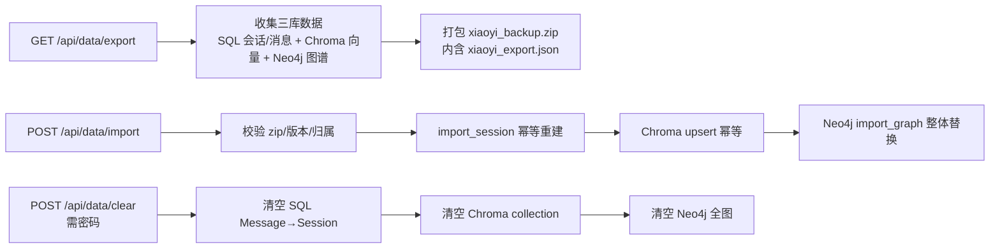

# 09_数据管理详解

> 数据管理（章节号 `09 §`）：设置页数据管理区 + `backend/app/api/data.py` + 备份脚本 `backend/scripts/`。
> 相关文档：[01_项目初始计划详解](01_项目初始计划详解.md)（API 总览）· [06_一键启动详解](06_一键启动详解.md)（卷名约定）· [07_会话历史记录详解](07_会话历史记录详解.md)（会话导入/导出）· [11_2D虚拟人物详解](11_2D虚拟人物详解.md)（前端依赖）

## 1. 设置页数据管理区

| 操作 | 说明 |
|---|---|
| 全库导出 | 下载 `xiaoyi_backup.zip`（内含 `xiaoyi_export.json`，见下） |
| 导入恢复 | 上传 zip 全库恢复 |
| 清空数据 | 需输入**当前用户登录密码**（非 `DB_PASSWORD`，非管理密码），硬删除 SQL 数据（会话/消息），同步清空 Chroma / Neo4j |

## 2. 数据流总览



## 3. 导出（09 §4）

- **导出**：`GET /api/data/export` 返回 zip（`Content-Disposition: attachment; filename=xiaoyi_backup.zip`），zip 内单文件 `xiaoyi_export.json`（用户资料 + 会话/消息含 `thinking`/`source` + 向量 + 图谱全量 JSON，`ensure_ascii=False, indent=2`）。
- **只导出当前用户的数据**（09 §4.1）：SQL 按 `user_id` 过滤，Chroma 按 collection 隔离，Neo4j 节点带 `user_id` 属性。
- **健壮性（09 §4.1）**：外部存储（Chroma / Neo4j）导出时可能暂时不可用，不阻断主流程，收集 `warnings` 随响应返回，前端提示后用户可重试。

## 4. 导入（09 §5）

- **导入**：`POST /api/data/import` 接收 zip，必须含 `xiaoyi_export.json`（否则 400「备份文件缺少 xiaoyi_export.json」）。
- **校验链**：zip 合法性 → 解压限流（`_LimitedReader`，zip 炸弹防护，解压上限 = 导入上限 5 倍）→ 版本校验（`version == "1.0"`）→ 归属校验（备份 `user_id` 必须等于当前用户，否则 403）。
- **SQL 合并策略**：`import_session` 幂等——已存在的 id 跳过，新数据插入。
- **Chroma**：按 id 幂等 upsert（已存在 id 覆盖为一致，09 §5）。
- **Neo4j**：`import_graph` 备份恢复 = 整体替换——先 `clear_graph` 再导入（09 §5），防重复导入复制节点；自我/机器人节点由兜底方法重建。
- **三层行为差异（勿混用）**：导入时 SQL 是「幂等合并」（已存在 id 跳过）、Chroma 是「幂等 upsert」（已存在 id 覆盖）、Neo4j 是「整体替换」（先清后导）。因此**建议只做全量导入 / 全量清空**；单层清空需谨慎——例如只清 SQL 不清 Neo4j 时，图谱仍保留已删会话的实体引用（`delete_or_soft_delete_session_refs` 仅在删除会话时清理）。
- **大文件断流防护**：`_LimitedReader` 包装 request 流，超过阈值（默认 10MB）写临时文件，防超大备份打爆内存；Content-Length 超 `MAX_IMPORT_SIZE`（50MB）直接 413。

## 5. 清空（09 §6，需密码确认）

- `POST /api/data/clear`：校验**当前用户登录密码**（`verify_password(user, ...)`）后按 `type` 分三档执行——`sql` / `chroma` / `kg` / `all`。
- SQL 清空调用 `memory_engine.clear_messages_and_sessions`（按 FK 顺序删 `Message → Session`，09 §6）；再清空 Chroma collection（`clear_collection`）与 Neo4j 全图（`clear_graph`）。
- 清空后侧边栏只剩一条「新会话」；各层失败降级为 `warnings` 返回，不阻断。

## 6. 备份脚本（`backend/scripts/backup.py` / `restore.py`，09 §7）

```bash
python backend/scripts/backup.py    # 全量备份
python backend/scripts/restore.py   # 全量恢复
```

- 用 `docker run --rm -v xiaoyi_*_data:/var/lib/postgresql/data ...` 方式挂载**显式卷名**备份（Postgres `pg_dump` / Neo4j dump 中转卷 `xiaoyi_neo4j_dumps` / Chroma 目录拷贝）。
- **依赖 compose 卷的 `name:` 显式声明**：若卷名被 Compose 自动生成（如 `backend_neo4j_data`），备份脚本会挂载到空卷。卷改名必须 compose + backup.py + restore.py 三处同步。
- `restore.py`（09 §7.1）与 `backup.py` 对称：stop → 操作 → start。

## 7. 命名统一

文件/zip 命名统一 `xiaoyi_export.json` / `xiaoyi_backup.zip`（不残留 xiaona_ 旧名）。
