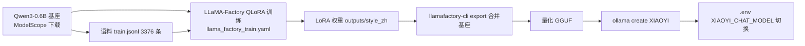

# 10_模型微调详解

> 小亦（XIAOYI）离线微调「说话风格模型」的设计文档。命令细节与完整操作手册见 `训练/README.md`，本文档聚焦设计决策与踩坑教训。微调目标：基于开源基座，用本地语料塑造「小亦」说话风格，接入 Ollama 作为 chat 槽位。
> 相关文档：[01_项目初始计划详解](01_项目初始计划详解.md)（模型分配 §4）· [06_一键启动详解](06_一键启动详解.md)（env 配置）· [11_2D虚拟人物详解](11_2D虚拟人物详解.md)（模型资源/许可）· 操作手册 `训练/README.md`

## 1. 目标

用本地硬件微调一个「小亦说话风格」模型，替代默认聊天模型，全程离线、不调云端 API。训练完成后经 `训练/README.md` 第 5/6 节导出量化导入 Ollama，后端只需改 `.env` 的 `XIAOYI_CHAT_MODEL` 即可切换（见 `01 §4`）。

## 2. 硬件边界

RTX 2050 约 4GB 显存，约束整个方案：

- **v1~v3 基座选 `Qwen/Qwen3-0.6B`**（QLoRA 4-bit 训练峰值约 4GB 内，稳妥）；`Qwen3-1.7B` 为次选（卡在 4GB 边缘）。
- **v4 曾升级 `Qwen/Qwen3-4B` 尝试（2026-08-29~30），已放弃并回退 `Qwen/Qwen3-1.7B`**：4B 虽理解力大幅提升，但 4GB 显存处于临界（需 rank 16 + cutoff 512 + 8bit 优化器），且单轮训练约 5~8 小时、中途反复因系统崩溃/断电中断，实测不可行。回退 1.7B（理解力优于 0.6B、4GB 稳跑、约 2~3 小时/轮），恢复 rank 32 / alpha 64 / cutoff 1024（详见台账 2026-08-30 第五节）。
- 7B/8B 级（如 qwen3:8b）训练不可行；即使用于语料生成也因模型放不进显存而退化为 CPU 推理，速度不可接受。
- 中文语料下 Qwen 系显著优于 Llama 3（原生中文分词、更省显存）。
- 推理侧无压力：合并导出后量化 GGUF，0.6B/1.7B 量化后随便跑。

## 2.5 环境准备（本地训练环境）

- **Python 3.10+ 与 CUDA 版 PyTorch**（Windows 直接装 torch + cu121/cu124）。本项目实际用 uv 管理的 `.venv`（Python 3.12，`D:\XIAOYI\训练\.venv`），注意该 venv **创建时无 pip**，但 torch/transformers/sentencepiece/tiktoken/modelscope 等依赖已齐，无需再装任何包。
- **LLaMA-Factory**：`pip install -e .[torch,bitsandbytes]`（venv 内直接装好）。**CLI 入口注意**：`llamafactory-cli.exe` 是 pip 生成的未签名启动器，会被 Windows 应用控制策略拦截（2026-08-29 实测），一律改用 `python -m llamafactory.cli` 等价入口。
- **下载基座模型**（国内用 ModelScope；`.venv` 无 pip 但 modelscope 已装，repo_id 是位置参数）：

```bash
cd D:\XIAOYI\训练
# v1~v3 用 0.6B；v4 起用 1.7B（4B 已尝试后回退，见 §2）
.\.venv\Scripts\modelscope.exe download Qwen/Qwen3-0.6B --local-dir models/Qwen3-0.6B
.\.venv\Scripts\modelscope.exe download Qwen/Qwen3-1.7B --local-dir models/Qwen3-1.7B
# 或 HuggingFace：huggingface-cli download Qwen/Qwen3-1.7B --local-dir models/Qwen3-1.7B
```

- **Ollama**：装好后 `ollama pull bge-m3`（embedding）、`ollama pull qwen3`（备用聊天；4GB 显存跑 qwen3:8b 退化为 CPU 推理约 2 分钟/次，已不用）。微调模型经 GGUF 导入后由后端读 `.env` 的 `XIAOYI_CHAT_MODEL` 使用。

## 3. 语料来源与处理流水线

> **2026-09-03 现状更新**：语料库在 09-02 基础上完成**最终定稿**——41 个 md 全部重筛清理（引号/错字/病句/风格，见 09-03 台账「语料定稿」节），总条数 12875。**v6 起合并改为可复用脚本 `训练/build_dataset.py`**（9/2 的一次性脚本已删），train/test 刷新为 **12232 / 643 条**。旧语料（Muice 小亦化 + docx 解析等，见下方 3.1~3.6）因风格不合适已全部弃用并删除；**v5 起语料直接来自桌面语料库 `D:\XIAOYI语料库\已完成语料`**（7 类 41 个 md，内嵌 JSONL 共 12875 条，JSON 全合法、无重复）。旧流水线仅作历史记录保留。新合并流程见 §3.7。

旧语料处理是一个多步流水线（脚本均在 `训练/` 下，全部可复现），从 Muice-Dataset 原始语料一路加工到最终训练集 `merged_train.jsonl`：

```
Muice-Dataset 下载（沐雪 3.7k）
  → rename_muice.py（小亦化：角色名替换 + 俏皮自称）
  → filter_muice.py（精炼：删占位符/纯怼人短句）→ old_data.jsonl（2904 条）
  → clean_legacy_names.py（二次清扫旧称呼）→ 残留清零
  → parse_docx.py（哲理对话 docx → new_data.jsonl 2996；防沉迷 docx → new_guard_data.jsonl 100）
  → gen_fix_corpus.py（对症修复 → new_fix_data.jsonl 267）
  → parse_long_docx.py（哲理长语料 docx → new_long_data.jsonl 300）
  → gen_praise_data.py（傲娇夸人 → new_praise_data.jsonl 100）
  → merge_corpus.py（合并 + 洗牌 + 95/5 切分）→ merged_train.jsonl（6667）/ merged_test.jsonl（333）
```

### 3.1 Muice-Dataset 小亦化（`rename_muice.py`，2026-08-27）

选用开源角色扮演语料 [Moemu/Muice-Dataset](https://huggingface.co/datasets/Moemu/Muice-Dataset)（沐雪，3.7k 条，ShareGPT 风格）。替换规则（防误伤白名单：`雪糕`/`冰雪`/`雪花`/`下雪`/`雪灵灵`/`雪上加霜`/`裁雪为画`/`张雪`/`轻雪`/`沫雪`/`雪♡雪`）：

| 原词 | 新词 | 说明 |
|---|---|---|
| 沐雪 | 小亦 | 角色名（含 system 人设） |
| 雪雪 | 亦亦 | 叠字昵称 |
| 小雪雪 / 小雪 | 小亦亦 / 小亦 | 昵称 |
| 本雪 | 本大王 | 自称俏皮化 |
| 我是/我叫沐雪 | 我是/我叫亦大王 | 自我介绍 |
| 沐沐 | 星辰学长 | 开发者名字 |
| 单字「雪」（独立称呼） | 亦 | 如"和雪聊天→和亦聊天" |

结果：`train.jsonl` 3376 条 / `test.jsonl` 100 条（v1 用，后删除）。

### 3.2 精炼（`filter_muice.py`，2026-08-28）

原始 `train.jsonl`（3376 条）混有伤害对话连贯性的样本，过滤规则：

1. **删除占位符提示样本**：user 输入以 `<` 开头（`<生成推文: ...>` 等）——让模型学到"看到指令就生成文体"而非"接住用户的话"，是答非所问的重要来源。
2. **删除"全部回复都是纯怼人短句"的样本**：无实质信息的抬杠式短句，无法训练"先理解、再围绕话题回应"。

结果：train 3376 → 2904（`old_data.jsonl`，14.0% 删除率）；test 100 → 87（已删，old 只保留一份备份）。

### 3.3 旧称呼残留二次清扫（`clean_legacy_names.py`，2026-08-28）

第一轮替换后仍残留部分旧称呼，二次清扫：`雪门（合掌）→亦门（合掌）`、`沐头→小亦`、`小亦姓沐喵→小亦姓亦喵`、`沫雪/雪沐→小亦`、`雪宝/雪式→亦宝/亦式`、单字「雪」独立称呼→「亦」。白名单（如沐春风、雪糕、张雪、轻雪等）保留。清扫后 `old_data.jsonl` 旧称呼残留为 0。

> 注意：`filter_muice.py`/`clean_legacy_names.py` 的输入 `train.jsonl`/`test.jsonl` 已删除，复现需先从 HuggingFace 重新下载 Muice-Dataset。

### 3.4 哲理对话 + 防沉迷（`parse_docx.py`，2026-08-28）

纯标准库解析（不依赖 python-docx），读取桌面用户提供的 docx：

- `小亦对话语料.docx`（3000 组「星辰：Q 小亦：A」一问一答，哲理温柔为主）→ `new_data.jsonl`（2996 组，去重后）
- `小亦防沉迷语料库.docx`（100 组「表白 → 俏皮坚定拒绝」人机边界）→ `new_guard_data.jsonl`（100 组）
- `小亦单句语料.docx`（1000 句金句）→ `new_single_data.jsonl`（**仅留档，不进训练集**——无用户输入侧，直接训练会让模型学会"莫名蹦名言"）

### 3.5 对症补充（`gen_fix_corpus.py`，2026-08-29）

针对 v3 实测暴露的"前言不搭后语/边界不清"问题，编写正确示范语料 `new_fix_data.jsonl`（267 条）：

| 类别 | 条数 | 修复目标 |
|---|---|---|
| A 求助必答 | 81 | 正常求助必须认真回答，杜绝"不告诉你/你猜" |
| B 情绪必温柔 | 65 | 情绪低落必须温柔安慰，杜绝嘲讽反问 |
| C 防沉迷强化 | 65 | 表白/结婚/变真人一律坚定俏皮拒绝 |
| D 复读修正 | 28 | 被骂时有创意回怼，不重复原话 |
| E 逻辑围绕话题 | 28 | 正常提问围绕话题，消灭串词答非所问 |

### 3.6 哲理长语料 + 傲娇夸人（2026-08-29）

针对 v3 实测"回答太短（平均约 20 字）"与"哲理/夸奖场景不够展开"，新增两份长回复语料：

- **哲理长语料** `new_long_data.jsonl`（300 条）：`parse_long_docx.py` 解析桌面 `新建 Microsoft Word Document (2).docx`（6 类×50 组「星辰：Q 小亦：长答」），回答平均 **114 字**（最长 158），每条"理解问题→展开→收尾"，是"逻辑连贯 + 长回复"教学范本。
- **傲娇夸人语录** `new_praise_data.jsonl`（100 条）：`gen_praise_data.py` 生成用户整理的《小亦傲娇夸人语录》（001~100，标题"200组"为笔误）。用户分享进步/求表扬 → 小亦"先损后夸"，回答平均 63 字。补"夸奖场景" + 长回复。

### 3.7 合并（v5/v6 流程）

**v6 起**：可复用脚本 `训练/build_dataset.py`（v5 用的一次性 `python -c` 内联脚本已不保留）递归提取 `D:\XIAOYI语料库\已完成语料\**\*.md` 中所有 `{"system"...}` 行 → `json.loads` 校验 → 转换为 sharegpt 标准结构 → `random.seed(42)` 打乱 → 95/5 切分：

- 转换规则：顶层 `conversation` → `conversations`；对话内 `{"human":H,"assistant":A}` → `[{"from":"human","value":H},{"from":"gpt","value":A}]`（多轮样本按序展开；**按字段显式追加**，规避 09-02 台账「assistant 全丢」坑）。内容一字不改。
- v6 重建（2026-09-03，最终定稿语料）：`merged_train.jsonl`（**12232 条**，95%）/ `merged_test.jsonl`（**643 条**，5%），总 12875 条。
- **多轮样本**：全量 12875 条中多轮 1626 条（12.6%，2 轮 816 / 3 轮 405 / 4 轮 313 / 5 轮 82 / 6 轮 9 / 7 轮 1），train 多轮 1549 条（12.7%）比例保持一致。视觉类多轮首轮统一「你现在看到：」格式，与双模型级联链路吻合。
- 已在 `data/dataset_info.json` 注册 **`merged_train` / `merged_test`**（sharegpt：`conversations`/`system`，tag `from/value`，user `human`、assistant `gpt`；`file_name` 不带 `data/` 前缀）
- `data/` 目录最终保留：`merged_train.jsonl` / `merged_test.jsonl`（训练用）、`dataset_info.json`（注册）

> **旧流程（v1~v4，已废弃）**：`SOURCES = [old_data, new_data, new_guard_data, new_fix_data, new_long_data, new_praise_data]` → 洗牌 → 95/5 切分，产出 `merged_train.jsonl` 6667 条 / `merged_test.jsonl` 333 条，注册名 `muice_merged_train`/`muice_merged_test`（2026-08-28 现状更新：v1 语料 `train.jsonl`/`test.jsonl` 及注册已删，v2 起统一用 `muice_merged_train`）。2026-09-01 旧语料全部弃用删除。

## 4. 训练流水线



LLaMA-Factory QLoRA，配置见 `训练/llama_factory_train.yaml`（v1，数据源已删）。**v2/v3 实际训练用 `训练/train_muice_v2.yaml`（`dataset: muice_merged_train`）**，**v4 起用 `训练/train_muice_v4.yaml`（基座回退 `models/Qwen3-1.7B`——4B 尝试后放弃，见 §2；语料 6667 条，配置 rank 32 / cutoff 1024 + 8bit 优化器 + 断点续训保障，见 §5.4）**，**v5 起语料换新：`dataset: merged_train`（12137 条，见 §3.7）**，**v6 起语料定稿重建：`dataset: merged_train`（12232 条，配置同 v5，仅 output_dir 换 `outputs/style_zh_v6`，见 `训练/train_muice_v6.yaml`）**。关键参数：

| 项 | 取值 | 说明 |
|---|---|---|
| 基座 | `models/Qwen3-1.7B`（v4 回退；v1~v3 是 `models/Qwen3-0.6B`；4B 已放弃） | ModelScope 下载 |
| template | `qwen3_nothink` | qwen3 专用模板，关闭思考链，纯聊天风格 |
| finetuning_type | `lora` + QLoRA 4-bit | 4GB 显存必需 |
| lora_rank / alpha | `32` / `64` | 4B 版曾压到 16/32 |
| lora_target | `all` | 全部线性层 |
| dataset | `merged_train`（v5 起；v2~v4 为 `muice_merged_train`） | 见 §3d/§3.7 |
| cutoff_len | `1024` | 4B 版为省显存降到 512 |
| dtype | `fp16: true`（0.9.5 布尔字段；旧版 `dtype` 已废弃） | RTX 2050 为 20 系，不支持 bf16 |
| `do_train` | `true` | 必须显式声明，否则 LoRA 不注入（见 §5.1） |

**终端输出美化**（可选）：默认 CLI 每 `logging_steps` 打印一行 `{'loss': 2.3456, 'learning_rate': ..., 'epoch': ...}` 字典。想改成对齐表格（`Step/Loss/LR/Epoch/Progress` 五列，无 tqdm 进度条、进度是数字列），用启动器替代 CLI：

```bash
cd D:\XIAOYI\训练
.\.venv\Scripts\python.exe train_v5_pretty.py train_muice_v5.yaml
```

`train_v5_pretty.py` 通过 `run_exp(callbacks=[PrettyLogCallback()])` 注入自定义回调（transformers `TrainerCallback`）；yaml 需配 `disable_tqdm: true`（配合 `PrinterCallback` 替代 `ProgressCallback`），脚本再把 `ProgressCallback`/`PrinterCallback` 的 `on_log`/`on_train_begin`/`on_step_end`/`on_train_end` 全部静音，进度条与 dict 行均消失、只留对齐表格——不修改 `.venv` 库文件、不影响训练本身。输出示例：

```
  Step        Loss          LR     Epoch   Progress
-------------------------------------------------------
    10      5.6080    7.26e-06      0.01    10/4116
   200      3.2150    6.90e-05      0.15   200/4116
```

## 5. 踩坑记录

### 5.1 `do_train: true` 缺失导致静默崩溃

LLaMA-Factory 的 CLI 路径不会自动设置 `do_train`，若 yaml 缺失该字段，模型以 `is_trainable=False` 加载，**LoRA 适配器不注入**，日志表现为 `Number of trainable parameters = 0`，训练在第一个 `optimizer.step()` 时崩溃（`AssertionError: No inf checks were recorded`）。修复：yaml 显式声明 `do_train: true`。

### 5.2 dataset_info 的 `file_name` 不能带 `data/` 前缀

`dataset_dir: data` + `file_name: data/train.jsonl` 会被拼接成 `data/data/train.jsonl` 报 `File not found`。`file_name` 应只写 `train.jsonl`。

### 5.2b dataset_info 的 `columns` 必须显式写 `messages`（2026-09-01）

sharegpt 注册时若 `columns` 只写 `system` 而省略 `messages`，LLaMA-Factory 会用 `columns.get("messages", None)` **覆盖**掉 sharegpt 默认的 `conversations`，运行时 `converter.py` 报 `KeyError: None`。正确写法：

```json
{
  "merged_train": {
    "file_name": "merged_train.jsonl",
    "formatting": "sharegpt",
    "columns": { "messages": "conversations", "system": "system" }
  }
}
```

只要 `columns` 键存在，`prompt/query/response/history/messages/system/tools` 全部会被 `columns.get(k, None)` 重置——**所有想用的列都要显式写全**。tags（`from/value/human/gpt`）不在 `columns` 处理范围，仍用默认值，无需写。

### 5.3 语料生成路径不可行（已放弃）

曾尝试写 `gen_longchat.py` 用本地 qwen3:8b 批量生成长对话增补语料，实测不可行：8b 放不进 4GB 显存退化为 CPU 推理、生成极慢；改拉 4b 又因 Ollama 官方仓库约 47KB/s 需数小时。结论：**不新增生成语料，直接用现有 3376 条**，`gen_scripts/` 已删除。

### 5.4 断点续训保障（`train_resume.py`，2026-08-30）

#### 背景：LLaMA-Factory 自带自动续训，但有个完整性坑

LLaMA-Factory 本身支持续训：`output_dir` 存在且**未设 `overwrite_output_dir`** 时，启动会自动找最新 checkpoint 续训（`llamafactory/hparams/parser.py` 484-500 行）。但隐藏坑在于：`transformers.trainer_utils.get_last_checkpoint` **只按目录名 `checkpoint-N` 找编号最大的目录，完全不检查完整性**。若训练中断恰好发生在 checkpoint 保存中途，会得到一个"半成品"目录；续训选中它后，`transformers/trainer.py` 1416 行 `TrainerState.load_from_json` 对缺失的 `trainer_state.json` 无条件读取，直接崩溃。

2026-08-30 实际踩到：v4 训练跑到 500 步（21%）时 Windows 系统崩溃/重启，`outputs/style_zh_v4/checkpoint-500` 缺 `trainer_state.json` / `scheduler.pt` / `rng_state.pth`（只写了权重和 `optimizer.pt`），无法直接续训。

#### 完整性判断依据（checkpoint 写入顺序）

`transformers/trainer.py` 的 `_save_checkpoint` 保存顺序固定为：**权重（adapter_model.safetensors）→ `optimizer.pt` → `scheduler.pt` → `rng_state.pth` → `trainer_state.json`（最后写入）**。因此 `trainer_state.json` 存在即代表前面全部写完、该 checkpoint 是完整的。`train_resume.py` 据此用 4 个必需文件做完整性检查：

```python
REQUIRED = ["adapter_model.safetensors", "optimizer.pt", "scheduler.pt", "trainer_state.json"]
```

#### CLI 覆盖参数语法坑（OmegaConf）

LLaMA-Factory 的 `read_args`（`hparams/parser.py`）用 `OmegaConf.from_cli(sys.argv[2:])` 合并 CLI 覆盖参数，**只支持 `key=value` 语法**，`--key value` 形式解析不出来（实测验证：`--resume_from_checkpoint <path>` 会被解析成两个无效键）。因此续训必须写成：

```bash
.\.venv\Scripts\python.exe -m llamafactory.cli train train_muice_v4.yaml resume_from_checkpoint=D:\XIAOYI\训练\outputs\style_zh_v4\checkpoint-500
```

#### 方案：`训练/train_resume.py` 启动器

写启动器 `训练/train_resume.py` 在自动续训基础上加一层完整性保障：

1. 扫描 `outputs/style_zh_v4/checkpoint-*`，按编号降序找第一个**必需 4 文件齐全**的完整目录；
2. 扫描到的不完整 checkpoint 移到 `outputs/_incomplete/` 隔离（不删除，可排查）；
3. 找到完整 checkpoint → 用 `resume_from_checkpoint=<路径>`（key=value 语法）续训；一个都没有则从头训。

```bash
cd D:\XIAOYI\训练
.\.venv\Scripts\python.exe train_resume.py            # 默认：有完整 checkpoint 就续训，否则从头
.\.venv\Scripts\python.exe train_resume.py --fresh    # 从头训练（先把现有 outputs 移走备份）
.\.venv\Scripts\python.exe train_resume.py --dry-run  # 预演：只打印将执行的操作，不真跑
```

配套 yaml 调整（`训练/train_muice_v4.yaml`）：`save_steps: 500 → 200`（每 200 步保存，中断最多损失约 2.6 小时）、`save_total_limit: 2 → 3`（多留一个回退 checkpoint）；**严禁加 `overwrite_output_dir: true`**（否则禁用自动续训）。

### 5.5 Windows 智能应用控制（SAC）拦截 pyarrow（2026-08-30）

**现象**：`python -m llamafactory.cli train` 启动即崩，`import pyarrow` 失败：

```
ImportError: DLL load failed while importing lib: 应用程序控制策略已阻止此文件。
```

**定位**：注册表 `HKLM\SYSTEM\CurrentControlSet\Control\CI\Policy\VerifiedAndReputablePolicyState = 0x1`（SAC 强制模式开启）；事件查看器 `Microsoft-Windows-CodeIntegrity/Operational` 事件 3077/3033 明确指向 `...\pyarrow\arrow.dll` 未达 Enterprise signing level（Policy ID `{0283ac0f-fff1-49ae-ada1-8a933130cad6}` 即 SAC 策略）。

**根因**：pyarrow 的 `arrow.dll` 来自 PyPI wheel、**未签名**（`Get-AuthenticodeSignature` 返回 `NotSigned`），SAC 强制模式下拒绝加载。与 8/29 拦 `llamafactory-cli.exe` 同类（那次是 exe 级、可用 `python -m` 绕开），这次是 **DLL 级、无法绕开**。

**修复（唯一途径，不可逆）**：Windows 安全中心 → 应用和浏览器控制 → 智能应用控制 → 关闭。需管理员权限（UAC）；**关闭不可逆**（除重装系统无法再开启）；**必须重启电脑**才生效（策略开机加载）。补 DLL 签名 / 换 pyarrow 版本 / 换 Python 发行版均无效——SAC 拦的是"未签名 DLL"这件事本身。

**验证**：关闭 SAC + 重启后 `import pyarrow` 恢复（`pyarrow OK 25.0.1`），训练正常启动。

## 6. 训练结果（按版本）

| 版本 | 基座 | 语料 | 步数/时长 | train_loss | 产物 |
|---|---|---|---|---|---|
| v1（08-28） | Qwen3-0.6B | train 3376 | 1266 步 / 3 epoch / 1h38m | 2.1773（末段约 1.33） | `outputs/style_zh/` |
| v2（08-28） | Qwen3-0.6B | merged 5605 | — | — | `outputs/style_zh_v2/` |
| v3（08-28） | Qwen3-0.6B | merged 5700 | 2139 步 / 3 epoch / 2.7h | 1.928 | `outputs/style_zh_v3/` |
| v4（08-30 训练中） | Qwen3-1.7B（4B 已回退） | merged 6667 | 约 2~3h 预估 | — | `outputs/style_zh_v4/` |
| v5（09-02 已完成） | Qwen3-1.7B | merged 12137（新语料库，含 1517 条多轮） | 4554 步 / 3 epoch / 7h31m | 1.77（末段约 1.30） | `outputs/style_zh_v5/` |
| v6（09-03 待训） | Qwen3-1.7B | merged 12232（语料定稿重建，含 1549 条多轮） | 待训 | — | `outputs/style_zh_v6/` |

- v1 评估缺口（Phase D 手动补跑）：本轮未做 `--val_size` 划分，只有 train_loss 无独立 test loss，结论缺少测试集支撑。补跑建议：`llamafactory-cli train` 加 `--val_size 0.05` 与 `--eval_steps 100` 重训一次拿 test loss。
- v3 训练速度参考：4GB 显存 + batch=1 约 4.4s/it；loss 在 2.6~3.0 间波动属正常（batch=1 单样本噪声 + 小模型平台期），收敛到 1.93 为健康信号。
- v4 曾用 4B 训练两次：第一次 500 步（21%）时 Windows 系统崩溃中断（`checkpoint-500` 不完整），第二次又中断留下 `_incomplete/checkpoint-200`；4B 单轮 5~8h 太长、反复中断，最终放弃并回退 1.7B（详见 §2 与 §5.4）。

## 7. 导入 Ollama（2026-08-28 已完成）

1. `llamafactory-cli export` 合并 LoRA 到基座 → `exports/style_zh_merged`（产物 `model.safetensors` 1.19GB + 自动生成 `Modelfile`，命令见 `训练/README.md` §5）。
2. **踩坑（Qwen3 架构不能直导 safetensors）**：直接 `ollama create XIAOYI -f Modelfile`（FROM 指向 safetensors 目录）报 `unsupported architecture "Qwen3ForCausalLM"`。Ollama 的 safetensors 直导只支持 Llama/Mistral/Gemma 等子集，**Qwen3 必须先转 GGUF**（此限制至今有效，含最新版 Ollama）。
3. **踩坑（转换脚本不完整）**：只拷贝 `convert_hf_to_gguf.py` 单文件会缺 `conversion/` 与 `gguf-py/` 依赖（报 `ModuleNotFoundError` / `No module named 'gguf'`）；`git clone --depth 1` 完整 llama.cpp 即可解决。另外 `.venv` 创建时无 pip（`pip.exe` 不存在），但 torch/transformers/sentencepiece/tiktoken 依赖已齐，无需再装。
4. **成功导入**：`llama.cpp/convert_hf_to_gguf.py` 将 `exports/style_zh_merged` 转为 `exports/XIAOYI.gguf`（Q8_0，633MB），写 `exports/Modelfile`（FROM 指向 `.gguf`）后 `ollama create XIAOYI` 成功。`ollama list` 显示 639MB，`ollama run` 正常应答（"你好！我是一只AI主播，致力于用文字打动人心…"）。后端容器内 `host.docker.internal:11434` 可访问宿主机 Ollama 并识别该模型。
5. `.env` 的 `XIAOYI_CHAT_MODEL=XIAOYI` 本就指向它，无需改；重启 `python start.py`（带构建）即可在聊天/桌面助手生效。

> 完整命令清单（含版本确认、克隆、转换、导入、验证）见 `训练/导入Ollama命令清单.md`，`训练/README.md` §7 已如实记录。
