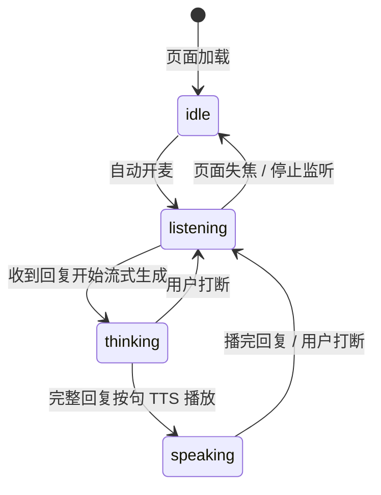
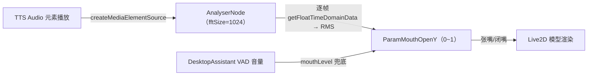

# 11_2D虚拟人物详解

> 桌面助手页的 2D Live2D 虚拟形象（`frontend/src/components/VirtualAvatar.jsx`，章节号 `11 §`）。
> 相关文档：[08_桌面助手详解](08_桌面助手详解.md)（桌面助手页集成）· [05_前端详解](05_前端详解.md)（组件清单/懒加载）· [04_语音输入与识别详解](04_语音输入与识别详解.md)（ASR/TTS 链路）· [12_视觉功能详解](12_视觉功能详解.md)（背景切换）

## 1. 需求动机

桌面助手页原本在页面中央显示一个圆形「监听中/已停止」占位 + 音量条，缺少人格化形象。作为聊天陪伴机器人，一个会呼吸、会眨眼、听你说话时微微侧头、回话时张嘴的虚拟人物，比麦克风图标更有"陪伴感"。

本功能把圆形占位替换为 **2D Live2D 虚拟人物**，全程本地渲染、不接任何云 API，符合项目纯本地约束。

## 2. 技术选型（Live2D vs 3D vs 帧动画）

| 方案 | 适合度 | 说明 |
|---|---|---|
| **Live2D（2D）** | 采用 | 二次元虚拟人物的标志性方案；眨眼/呼吸/口型同步/头发飘动全是内置能力；WebGL 渲染轻量，低端硬件可跑 |
| 3D（VRM/Three.js） | 排除 | 建模门槛高、渲染开销大，对低功耗设备不友好 |
| 帧动画（GIF/序列帧） | 排除 | 只能循环播放，无口型同步与交互 |

### 依赖与版本

- `pixi.js` v8：渲染引擎。
- `untitled-pixi-live2d-engine/cubism`：PixiJS v8 的 Live2D 插件（Cubism 3/4/5 运行时入口），提供 `Live2DModel.from()` / `motion()` / `expression()` / 实时口型同步。
- Cubism WebGL 运行时 `live2dcubismcore.min.js`：由 `frontend/index.html` 的普通 `<script>` 标签全局挂载（引擎依赖全局 `Live2DCubismCore`），文件放 `frontend/public/live2d/core/`。

## 3. 模型资源（免费模型 + 切换方式）

- 当前使用 Live2D 官方免费示例模型 **Hiyori**（女高中生，Cubism 3），下载自 [Live2D 官方示例](https://www.live2d.com/zh-CHS/learn/sample/)，个人 / 小企业（年销售额 < 1000 万日元）免费商用。
- 目录结构（`frontend/public/`，由 Vite 静态服务直接提供）：

```
public/live2d/
├── core/live2dcubismcore.min.js   # Cubism WebGL 运行时（index.html 挂载）
└── Hiyori/                         # 模型 runtime 文件夹
    ├── Hiyori.model3.json          # 模型入口（moc/贴图/动作/物理引用）
    ├── Hiyori.moc3                 # 核心模型数据（二进制）
    ├── Hiyori.2048/                # 贴图纹理
    ├── Hiyori.physics3.json        # 物理模拟（头发/裙摆飘动）
    ├── Hiyori.pose3.json           # 姿态
    └── motions/                    # Idle 组 9 个待机动作 + TapBody 1 个
```

- **切换形象**：把新模型的 runtime 文件夹放入 `public/live2d/` 下，改 `VirtualAvatar.jsx` 顶部 `MODEL_PATH` 一处即可。

## 4. 四态状态机

虚拟人物有四种状态，由 `DesktopAssistant.jsx` 的 `avatarState` 驱动（`11 §6`）。
**2026-09-03 起四态动作专属化**——不再"全部随机 Idle"：idle/thinking 由模型动作主导，listening/speaking 停播动作、由代码全权驱动姿态（差异肉眼可辨）：

| 状态 | 触发 | 动作模式 | 表现 |
|---|---|---|---|
| `idle` | 页面停止监听 | 播安稳 Idle 动作（m01/m07 随机） | 模型自然小动作 + 呼吸，无代码头身覆盖（不抢 motion） |
| `listening` | 开始监听 / 打断 / 回复播完 | **停播动作，代码全驱** | 歪头 -12° + 微笑 + 目光微垂 + 身体左右轻摇（±5°） |
| `thinking` | `streamChat` 流式输出中 | 固定播 m05（托腮/沉思感） | 长动作循环，眼神自然上移 |
| `speaking` | TTS 播放中 | **停播动作，代码全驱** | 正脸 + 微笑 + 口型随音频开合 + 点头/摆体幅度随口型开度平方（弱音不点头） |

> 实现要点（2026-09-03 四态差异化）：**旧实现把动作"调小"的根因是 `applyPose` 每帧把 motion 驱动的头/身参数拉回目标值**——现在 idle/thinking 不写头眼参数、完全交给 motion；进入 motion 态前先 `resetNeutralParams()` 归零残留姿态（防上一个代码 pose 如 -12° 歪头卡住）；listening/speaking 用 **`model.stopMotions()`**（模型层方法，内部转调 `motionManager.stopAllMotions()`；勿写成 `stopAllMotions()`——Live2DModel 无此方法会抛 TypeError）停播循环动作，由 `applyPose(t)` 代码驱动，并**补代码级眨眼（2~5s 一次 V 形）与呼吸**（写 `ParamBreath`）避免无 motion 显僵。代码态 lerp `ease=0.2`（更快到位），motion 态 `ease=0.1`。Hiyori 仅有 Idle/TapBody 动作组、无表情文件，"害羞 / 挥手跳舞"等情绪化肢体动作需更换带情绪动作组 + 表情文件的模型（见 §3 切换方式）。
>
> 附：Idle 组 9 个动作索引（`Hiyori.model3.json` 顺序，`model.motion('Idle', idx)`）：m01=0 m02=1 m03=2 **m05=3**（沉思，非 4） m06=4 m07=5 m08=6 m09=7 m10=8。TapBody 组 m04 为点击反应（播完即停，不循环）。



表情切换不是瞬间跳变：代码态（listening/speaking）`applyPose` 每帧把各参数向目标值做 0.2 的 lerp 平滑逼近；进入 motion 态（idle/thinking）先归零再由动作 FadeIn 过渡，避免跳变或歪头残留。

## 5. 口型同步原理

口型复用项目既有的 Web Audio 技术（与 VAD 同源），不依赖音素级分析：



- `DesktopAssistant.jsx` 播放 TTS 时调用 `avatarRef.current.bindAudio(audio)`，把 `Audio` 元素接进 `VirtualAvatar` 内部专用 `AudioContext` 的 `createMediaElementSource` → `AnalyserNode`。
- `VirtualAvatar` 的 Pixi ticker 每帧从 `AnalyserNode.getFloatTimeDomainData` 算 RMS，乘以经验增益 3.5 映射为 0~1 开口度，写入 `ParamMouthOpenY`。
- `createMediaElementSource` 后必须 `analyser.connect(audioCtx.destination)`，否则音频不发声；同一 `Audio` 元素不可重复绑定（`boundAudioRef` 防重）。
- 专用 `AudioContext` 与页面 VAD 的 context 分开，避免互相干扰。
- **AudioContext 解锁策略（代码已实现）**：浏览器自动播放策略下 `AudioContext` 初始为 `suspended`，须在用户手势（点击 / 开始监听的开麦动作）后 `resume()`；首帧手势时解锁本页全部 AudioContext（VAD + 口型），否则 TTS 播放无声。每次页面回到前台若检测到 `suspended` 再尝试 `resume()`（权限策略解除后自动恢复）。
- 静音口型逻辑保留（`setMuted` 接口仍在），但桌面助手 UI 已移除静音开关（语音回复默认开启），当前无调用方。

## 6. 组件接口与接入点

### `VirtualAvatar` 组件（`frontend/src/components/VirtualAvatar.jsx`）

| 接口 | 类型 | 说明 |
|---|---|---|
| `state` | prop | `idle` / `listening` / `thinking` / `speaking`，驱动四态表情与动作 |
| `mouthLevel` | prop | 外部音量 0~1 兜底（默认 0；主路径由内部 AnalyserNode 驱动） |
| `size` | prop | 尺寸档位：`md`（默认，256px）/ `lg`（320px）/ `xl`（416px）——**fixed 尺寸旧用法**，聊天页等固定位可用 |
| `fill` | prop | **自适应模式**（桌面助手主视觉，2026-09-03 起）：容器由外部定尺寸（约半屏），画布 `ResizeObserver` 跟随容器、模型按容器高缩放并居中 |
| `bindAudio(el)` | ref 方法 | 把 TTS 的 `Audio` 元素接进口型同步 |
| `setMuted(v)` | ref 方法 | 静音时关闭口型驱动（UI 已无静音开关，保留接口备用） |

内部要点：`extensions.add(Live2DPlugin)` 注册渲染管道 → `pixiApp.init({backgroundAlpha: 0, preference: 'webgl', resolution: devicePixelRatio, autoDensity: true})` → `Live2DModel.from(MODEL_PATH)` → **`layoutModel()`：用 `model.getBounds()`（世界包围盒）增量校正——高度缩放到容器 ~94%、水平居中、包围盒中心放容器 52% 处**（Live2D 原点在脚底，直接 `position=画布中心` 会偏，故按包围盒对齐）→ Pixi ticker 驱动 `applyPose(t)`（`state` 变化时按 §4 动作模式切换：idle/thinking 播动作、listening/speaking `stopMotions()` 代码全驱）。卸载时销毁 Pixi App、关闭 AudioContext、断开 ResizeObserver。

### 接入点（`frontend/src/pages/DesktopAssistant.jsx`）

| 位置 | 内容 |
|---|---|
| `avatarState` state | `idle` 初始；`startListening` 成功→`listening`；`sendTurn` 流式开始→`thinking`；`kickSpeech`/`playReply` 播放→`speaking`；`onended`/失败/打断→`listening`；`stopListening`→`idle` |
| `avatarRef.current?.bindAudio(audio)` | `playReply` 与 `kickSpeech` 两处 `new Audio` 后绑定口型 |
| `<div class="flex-1 min-h-0 max-h-[min(54vh,620px)] w-auto aspect-[3/4]"><VirtualAvatar ref={avatarRef} state={avatarState} fill /></div>` | 主视觉：外层 flex 容器撑满剩余高度、封顶 `min(54vh,620px)`、3:4 竖构图；`fill` 让小人约占半屏、随窗口自适应（2026-09-03 起）；音量条/status 保持在人物下方 |

> `size="xl"`（416px 固定）仅作回退保留，桌面助手已改用 `fill` 自适应模式。

### 形象双轨（2026-09-03 Q 版改版）

- **桌面助手 = Live2D 动态形象**（`VirtualAvatar`）：承载语音交互的拟真陪伴，待机/倾听/思考/说话四态 + TTS 口型同步，本组件定位不变。
- **网页聊天页 = Q 版静态形象占位**：沉浸式单会话下用 `public/avatars/xiaoyi.png`（欢迎态 C 位头像 + 有对话后右下陪伴角），圆形裁切 + `animate-floaty` 轻浮动。当前为公有领域占位图，正式 Q 版立绘由用户替换同名文件即可（规格见 `05_前端详解.md` §8 与 `public/avatars/来源.txt`）。
- 未来若要把 Live2D 也接入网页聊天页 C 位，只需在该页复用 `<VirtualAvatar>` 并把 `/avatars` 素材换为 Q 版 Live2D 模型（`MODEL_PATH`，见 §3 切换方式）；两轨可共存，互不冲突。

## 7. 体积优化（懒加载）

`pixi.js` + Live2D 引擎体积较大（约 1MB 级）。`App.jsx` 用 `React.lazy(() => import('./pages/DesktopAssistant'))` + `<Suspense>` 做路由级代码分割：只有进入 `/desktop` 才下载 Live2D 相关 chunk，聊天页首屏不受影响。

## 8. 硬件屏幕扩展

- **带屏设备若运行浏览器**（树莓派 + HDMI 屏、安卓平板、带屏音箱）：直接打开 `/desktop` 页面即得完整虚拟人物对话，同一套代码零改动。
- **极简嵌入式**（ESP32 类小屏）：Live2D 太重跑不动，届时需降级为预渲染帧动画 / 低分辨率序列图，另开方案（本功能预留，不做实现）。

## 9. 许可说明

Live2D 免费示例素材遵循《免费提供素材使用许可合同》与《Live2D Cubism 示例数据使用条件》：个人用户与小规模企业（年销售额低于 1000 万日元）可用于商用与非商用创作（Unity-chan / 初音未来除外）。换用第三方模型时须另行核对各自授权。

**引擎许可**：
- **Live2D Cubism Core**（`live2dcubismcore.min.js`）：Live2D 官方 WebGL 运行时，随 SDK 免费提供，受 [Live2D Software License Agreement](https://www.live2d.com/eula/live2d-proprietary-software-license-agreement_en.html) 约束（免费使用，禁止逆向/转售等）。
- **untitled-pixi-live2d-engine**：MIT 许可，可自由商用（须保留版权声明）。
- **pixi.js v8**：MIT 许可。
