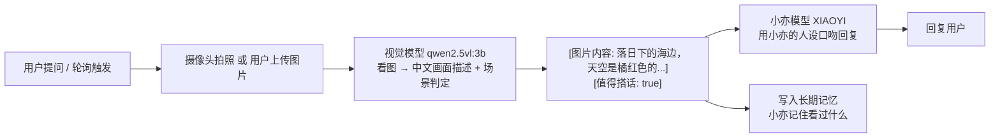

# 12_视觉功能详解

> 小亦的视觉能力设计：让"挂在胸前的小吧唧"能看见世界、看懂图片、配合场景聊天。
> 相关文档：[01_项目初始计划详解](01_项目初始计划详解.md)（总体架构）· [02_长期记忆详解](02_长期记忆详解.md)（记忆链路）· [11_2D虚拟人物详解](11_2D虚拟人物详解.md)（虚拟形象/背景）· [08_桌面助手详解](08_桌面助手详解.md)（桌面助手页）· [13_配套硬件详解](13_配套硬件详解.md)（吧唧硬件形态/立项讨论）
> 章节号 `12 §`。

## 1. 需求动机

小亦的硬件形态是**挂在胸前的小吧唧**（带摄像头、带屏幕、带麦克风/扬声器）。当她被挂在胸前或放在桌上时，用户希望她"看得见眼前的世界"：

- 用户问「你看一下这是什么」→ 小亦拍下眼前画面，识别场景/文字，配合聊天
- 挂着时**主动**感知环境：路过好看的风景 → 主动说「哇，今天的晚霞好美」
- 用户用网页/手机**上传**图片 → 简单图像识别与评论
- 画面里出现文字 → 翻译/解释

一句话：**小亦要有眼睛，但说话方式必须还是小亦。**

## 2. 架构决策：双模型级联（否掉训练多模态）

### 2.1 为什么不能"直接训练一个多模态模型"

在 [10_模型微调详解](10_模型微调详解.md) 的基础上，训练视觉模型有三道硬门槛：

1. **原理上"微调不出视觉"**：视觉能力是模型**架构自带**的。`Qwen3-0.6B` 是纯文本模型，没有视觉编码器（vision encoder）也没有图像投影层，无论喂多少文本语料都不会"长出眼睛"。要视觉，基座必须是 VLM（如 Qwen2-VL / Qwen2.5-VL / Qwen3-VL 系列）。
2. **数据上我们没有图**：训练 VLM 需要海量"图片 + 文字"配对语料（通常百万级），我们现有的 6000 条语料 100% 是纯文本对话，一张图都没有。
3. **硬件上训不动**：最小可用的 VLM 也要 2B+ 参数，训练显存需求远超 RTX 2050 的 4GB。

### 2.2 级联方案（采用）



关键收益：

- **小亦的人设 100% 保留**：说话永远是微调模型，俏皮、哲理、怼人、防沉迷边界都不受影响。
- **视觉能力由通用 VLM 提供**：不需要任何训练，`ollama pull qwen2.5vl:3b` 即得。
- **后端代码 95% 已就绪**：`media_utils.py` 已把图片转 base64、`memory_engine._build_user_content` 已构造 `image_url` 多模态消息、`chat.py` 已支持 `files[]` 上传，只差"换一个会看图的模型 + 一段描述桥接"。

### 2.3 模型选型

| 项 | 选型 | 说明 |
|---|---|---|
| 视觉模型 | `qwen2.5vl:3b` | 约 3.2GB，GPU 能跑（4GB 显存内），中文原生强，速度/效果平衡 |
| 对话模型 | `XIAOYI`（v3 微调产物） | 保持小亦人设，负责所有"开口说话" |
| 描述桥接 | 结构化 JSON | 视觉模型输出「画面描述 + 场景判定」，对话模型据此用小亦口吻组织语言 |

> 若后续 3b 视觉效果不满意，可换 `qwen2.5vl:7b`（更强但约 6GB，只能 CPU 慢跑，参照此前 `qwen3:8b` 的教训，每张图要几十秒）。

## 3. 两种拍照模式

### 3.1 主动轮询模式（挂着 / 放着时）

- **仅视觉模式开启时运行**（见 §5），关闭时摄像头永不打开。
- 默认每 **2 分钟**拍一张（间隔可配置：1 / 2 / 5 / 10 分钟），分析画面。
- 分析结果写入照片库（§6）与记忆（§6.3）。
- **主动搭话极其克制**（见 §4）。

### 3.2 触发 / 上传模式

- **语音触发词**：用户说「快看快看」「快看看」「你看」「看这个」→ 立即拍一张，截帧入库 + 走聊天链路回复。
- **网页上传**：在聊天页拖拽/选择图片 → 复用现有 `/api/chat/stream` 上传链路 → 视觉分析（对话模型不支持视觉时自动走描述桥接）。

## 4. 主动搭话策略（克制）

主动搭话不是"每张都夸"，而是**低频 + 高质量**：

- **频率**：约每 **100~200 张**才主动搭话一次（按 2 分钟/张 ≈ 3~6 小时一次）。由后端计数器控制：拍到第 N 张且满足条件才触发。
- **必须同时满足**：
  1. **好看**：视觉模型判定画面美观（风景 / 晚霞 / 可爱动物 / 有趣画面等）；
  2. **不私密**：无人物正脸 / 无室内隐私场景 / 无敏感内容；
  3. **值得说**：画面有"可说的点"，不是普通的墙 / 天花板 / 桌面杂物。
- **触发后冷却**：一次主动搭话后重置计数器，重新累计。

判定由视觉模型输出的结构化 JSON 提供（`is_pretty` / `is_private` / `worth_speaking` / `description`）。

## 5. 隐私保护：视觉模式开关

这是硬性要求——**用户在家里把吧唧放一边去洗澡时，绝不能让摄像头偷偷拍照。**

- **视觉模式开关**：全局开关，默认**关闭**（用户级 `User.vision_enabled`，`GET/PUT /api/vision/status`）。
  - **开启**：才允许轮询拍照、摄像头打开、主动搭话。
  - **关闭**：摄像头永不打开、不轮询、不拍照、不上传。此时小亦只是纯语音/文字聊天。
- **部署级总闸**：`XIAOYI_VISION_ENABLED`（默认 1=功能可用；设 0 时 `/status` 恒返回 false，前端即使曾开启也不恢复摄像头，彻底禁用视觉）。
- **开关状态持久化**：存后端（用户维度），网页刷新 / 重开设备后保持。
- **摄像头打开的可视化提示**：
  - **开启时**：桌面助手页背景 = 摄像头实时画面（小亦"在外面玩"），一目了然摄像头在工作。
  - **关闭时**：固定背景图（当前为白色，后续可换好看的图），小亦形象在前景。
  - 网页聊天页也有一个明显的「视觉模式」指示灯。

## 6. 存储设计：环形缓冲 1000 张

### 6.1 照片库（新表）

| 字段 | 类型 | 说明 |
|---|---|---|
| `id` | String(36) PK | uuid |
| `user_id` | str | 用户隔离 |
| `image` | text | base64 data url |
| `shot_at` | datetime | 拍摄时间 |
| `description` | text | 视觉模型生成的画面描述 |
| `is_pretty` / `is_private` / `worth_speaking` | bool | 场景判定 |
| `source` | str | `poll`（轮询）/ `upload`（上传）/ `trigger`（语音触发） |
| `spoken` | bool | 是否已用于主动搭话 |
| `is_favorite` | bool | 用户标记的收藏 |

> 2026-08-28 实施注：`Photo` 表位于 `backend/app/db/sql_models.py`，`create_all` 自动建表，无需手动迁移。

### 6.2 环形淘汰

- 上限 **1000 张 / 用户**（`XIAOYI_VISION_CAP`）。
- 新照片插入时，若超上限，删除该用户**最早**的非收藏照片（FIFO）。
- 用户可**收藏**：收藏的照片优先保留，不被自动淘汰（收藏数上限 `XIAOYI_VISION_FAV_CAP`，默认 100 张，防止无限增长）。
- 数据库不会无限膨胀。

### 6.3 与记忆系统衔接

- **触发 / 上传**的照片，其**场景描述文本**写入长期记忆（02 §5 的三层记忆链路），并抽取三元组进知识图谱——`vision_analyze` 把画面描述作为用户侧输入落库，走 `_persist_user` / `_persist_reply` 的既有记忆链路。
- **轮询**照片仅把描述存在照片库（供主动搭话判定与画廊展示），**不主动写长期记忆**——每 2 分钟一张的频率会污染记忆库。
- 效果：小亦"记得"你主动给它看过的晚霞 / 你的猫 / 上传的食谱截图，后续对话能引用。

## 7. 每日精彩照片墙（`/gallery`）

- **独立路由页** `/gallery`，导航栏「每日精彩」入口。
- 展示照片库中的照片（缩略图网格），点击可看大图 + 描述 + 拍摄时间。
- 支持**下载**（把 base64 存为文件）。
- 超 1000 张自动淘汰，被顶掉的无法再找回（未收藏时）。

## 8. 后端改造

### 8.1 配置（`backend/app/config.py`）

新增环境变量：

```python
XIAOYI_VISION_MODEL = os.getenv("XIAOYI_VISION_MODEL", "qwen2.5vl:3b")
XIAOYI_VISION_INTERVAL = int(os.getenv("XIAOYI_VISION_INTERVAL", "120"))   # 秒，默认2分钟
XIAOYI_VISION_ENABLED = os.getenv("XIAOYI_VISION_ENABLED", "1") == "1"     # 部署级总闸，默认开（设 0 彻底禁用视觉）
XIAOYI_VISION_CAP = int(os.getenv("XIAOYI_VISION_CAP", "1000"))            # 环形缓冲上限
XIAOYI_VISION_FAV_CAP = int(os.getenv("XIAOYI_VISION_FAV_CAP", "100"))     # 收藏上限
XIAOYI_VISION_TALK_EVERY = int(os.getenv("XIAOYI_VISION_TALK_EVERY", "150")) # 主动搭话周期（张）
```

### 8.2 视觉描述生成（`backend/app/core/llm_provider.py`）

- `_model_configs` 增加 `vision` 槽位（`XIAOYI_VISION_MODEL` / `XIAOYI_OLLAMA_BASE_URL`，temperature 低，如 0.1）。
- 新增 `describe_image(image_data_url, model_config) -> dict`：构造 `image_url` 消息，要求视觉模型输出结构化 JSON：

```json
{
  "description": "落日下的海边，天空橘红，海浪泛金光",
  "is_pretty": true,
  "is_private": false,
  "worth_speaking": true,
  "has_text": false,
  "text_content": ""
}
```

- 复用现有 `VisionNotSupportedError` 兜底逻辑：视觉模型不可用时，对轮询静默跳过、对用户提问回复"暂时看不了图"。

### 8.3 桥接进对话（`backend/app/core/memory_engine.py`）

- **上传图片路径**：`_build_user_content` 现在直接把 `image_url` 发给对话模型 → **改造**为：对话模型抛 `VisionNotSupportedError` 时，先调 `describe_image` 把图转描述文本，再把描述拼进 user 消息（`[图片内容]\n{描述}`）发给小亦模型（`_build_messages_bridge`）。桥接仍失败才退回聊天式友好回复。
- 新增 `vision_analyze` 入口：图片 → 描述 → 用小亦模型组织回复 → 落库 + 写记忆。**当前仅主动搭话使用**（`vision_proactive_talk` 复用，user_query 为空）；语音触发/网页上传的对话统一走前端聊天链路（截帧/上传作附件 → `/api/chat/stream` → 后端桥接），避免双重回复。`vision_analyze` 保留在 `chat_core` 供未来直接调用。

### 8.4 照片 API（新增 `backend/app/api/vision.py`）

| 端点 | 说明 |
|---|---|
| `POST /api/vision/photo` | 上传一张照片（轮询 / 触发 / 上传共用）；轮询命中主动搭话时在响应里返回 `proactive_reply` |
| `GET /api/vision/photos` | 分页列出照片（`/gallery` 用） |
| `GET /api/vision/photos/{id}/download` | 下载原图 |
| `POST /api/vision/photos/{id}/favorite` | 收藏 / 取消收藏 |
| `GET/PUT /api/vision/status` | 读 / 写视觉模式开关 |

> 2026-08-28 实施注：主动搭话未拆独立端点——`POST /photo` 的 `poll` 分支在满足「周期命中 + 好看 + 不私密 + 值得说」时同步生成回复并随响应返回 `proactive_reply`，前端拿到后直接展示 + TTS，避免额外请求。

## 9. 前端改造

### 9.1 摄像头与背景（`frontend/src/pages/DesktopAssistant.jsx`）

- 摄像头独立于麦克风流：视觉模式开启时 `getUserMedia({ video: true })`（`cameraStreamRef`），关闭立即停 tracks。
- 视觉模式开启时：
  - 打开摄像头视频流；
  - 背景显示实时画面（`<video>` 铺底 opacity-50 + Live2D 小亦叠在前景，`VirtualAvatar` 已有 `size="xl"` 主视觉）；
  - 定时器每 **120 秒**截帧上传 `/api/vision/photo`（`canvas.toBlob` JPEG 质量 0.8；前端与后端默认 `XIAOYI_VISION_INTERVAL=120` 保持一致）。
- 视觉模式关闭时：停止摄像头、清定时器、背景切回固定图。
- 语音触发词「快看快看」等在现有 ASR 转写里识别（正则 `/快看|快看看|你看|看这个/`，且仅视觉模式开启时生效）→ 截帧 + 同一帧作为附件走 SSE 对话链路。
- 页面加载时向后端 `GET /api/vision/status` 恢复上次开关状态。

### 9.2 聊天页上传（`frontend/src/components/ChatInput.jsx`）

- 2026-09-03 起（Q 版改版）**附件收窄为仅图片**：`ACCEPT = 'image/*'`，非图片直接拦截提示；已选图片显示缩略图预览（objectURL，发送/移除时 revoke），一次 ≤5 张、单张 ≤10MB。上传后走视觉链路（对话模型不支持图片时后端自动描述桥接）。

### 9.3 每日精彩页（新增 `frontend/src/pages/Gallery.jsx`）

- 照片墙网格 + 大图预览 + 描述 / 时间 + 下载按钮 + 收藏按钮。
- `App.jsx` 注册 `/gallery` 路由，`Navbar.jsx` 加「每日精彩」入口。

## 10. 实施计划

### 阶段一：后端视觉链路（打通"上传图 → 小亦回复"）

1. `ollama pull qwen2.5vl:3b`（用户侧执行，验证识别效果）。
2. `config.py` 加 vision 配置；`llm_provider` 加 `describe_image` 与 vision 槽位。
3. `memory_engine` 上传图片走"视觉描述 → 小亦回复"桥接（替代现在直接发图给纯文本模型）。
4. 照片表 + `vision.py` API + 环形淘汰 + 开关读写。
5. **验收**：网页上传一张风景图，小亦能用她的人设口吻描述并评论；开关可读可写。

> 2026-08-28 已实施完成（`python -m compileall -q backend/app` 静态检查通过）。

### 阶段二：前端摄像头与轮询（吧唧挂在胸前）

1. `DesktopAssistant` 扩展 `getUserMedia({audio, video})`，视觉模式开关。
2. 背景实时画面切换（开=实时，关=固定图）。
3. 轮询定时器 + 截帧上传；语音触发词「快看快看」。
4. **验收**：开启视觉模式 → 背景变成摄像头画面 → 每 2 分钟自动拍一张；说「快看快看」立即拍并回复；关闭后摄像头停止。

> 2026-08-28 已实施完成（需用户 `npm run build` 验证）。

### 阶段三：每日精彩 + 主动搭话

1. `/gallery` 照片墙 + 下载 + 收藏。
2. 主动搭话策略（100~200 张一次，好看+不私密+值得说）。
3. 记忆衔接（描述进长期记忆 + 知识图谱）。
4. **验收**：挂着 3~6 小时后小亦主动说一次风景；照片墙能看到历史照片并可下载；记忆能引用之前看过的东西。

> 2026-08-28 已实施完成（需用户实际挂机验证主动搭话效果）。

## 11. 隐私与安全要点

- 视觉模式默认关闭，关闭时**任何代码路径都不打开摄像头**。
- 照片默认本地存储（base64 进 SQLite / 文件），不上传任何云端。
- 主动搭话有"不私密"硬约束（无正脸 / 无室内隐私）。
- 开关状态持久化，重启不丢。
