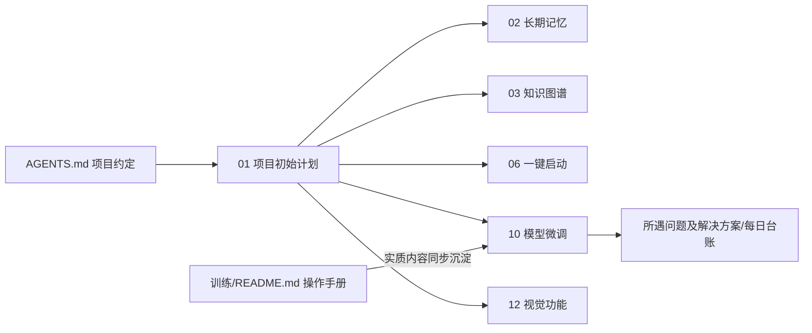

# 项目计划（XIAOYI 设计文档与问题台账）

> 小亦（XIAOYI）全部设计文档、结构决策与问题排障的权威归档。**本项目目录是唯一事实源**：
> 即使 `训练/README.md` 等操作手册删除/过时，仅凭本目录也应能看懂每个模块的架构、每个版本的演进与每个踩过的坑。

## 目录结构

```
项目计划/
├── 01_单Agent聊天助手/          # 模块设计文档（01~12），代码注释里的章节溯源（如 01 §5.2）即对应这里
│   ├── 01_项目初始计划详解.md   # 总览：目标 / 架构 / 模型分配 / API 总览 / 技术栈
│   ├── 02_长期记忆详解.md       # 三层记忆（工作记忆 / 语义检索 / 知识图谱）
│   ├── 03_知识图谱详解.md       # 图谱抽取 / 检索 / 遗忘
│   ├── 04_语音输入与识别详解.md # faster-whisper ASR + edge-tts TTS
│   ├── 05_前端详解.md           # React 组件与 SSE
│   ├── 06_一键启动详解.md       # start.py + docker-compose + env
│   ├── 07_会话历史记录详解.md   # 会话 CRUD / 导出
│   ├── 08_桌面助手详解.md       # 桌面助手页 + Live2D
│   ├── 09_数据管理详解.md       # 全库导出/导入/清空
│   ├── 10_模型微调详解.md       # 说话风格模型：语料流水线 / 训练 / 踩坑 / 续训保障
│   ├── 11_2D虚拟人物详解.md     # Live2D 虚拟形象（四态表情 + 口型同步）
│   └── 12_视觉功能详解.md       # 视觉双模型级联 / 拍照 / 每日精彩画廊
└── 所遇问题及解决方案/          # 按日期归档的问题台账（YYYY年M月D日所遇问题及解决方案.md）
```

## 文档维护约定（硬性）

1. **实时反哺**：每次代码改动、结构变动、新问题出现与解决，**完成后立即**同步更新本目录对应文档——尤其是 `01_单Agent聊天助手/` 下对应的模块详解，以及 `所遇问题及解决方案/` 当日台账。**不需要用户提醒**。
2. **README 不是源**：`训练/README.md`、`训练/导入Ollama命令清单.md` 等操作手册可能随时删除/过时；凡是写入 README 的实质内容（脚本、命令、规则、条数、版本结果），必须同步沉淀到本目录。判断标准：**README 删掉后，光看项目计划能否还原全部信息**。
3. **优先级：`01_单Agent聊天助手/` > `所遇问题及解决方案/`**：`01_` 是整个项目的核心计划与说明文件（长期权威）；台账只是实时的流水记录。凡遇到**麻烦/影响大的问题、改动面大的结构变化**，必须**及时把结论沉淀回 `01_` 对应模块文档**（新增/更新小节），不能只留在台账里。判断标准：问题解决后，`01_` 里的对应设计是否还自洽、是否覆盖了新认知。
4. **台账格式**：问题台账每节按「现象 → 根因分析 → 解决方案 → 验证 → 改动文件 → 文档反哺」记录；总述（〇节）列当日完成事项。「文档反哺」栏必须写清哪些结论沉淀到了 `01_` 哪个文档的哪个小节。
5. **章节溯源**：代码注释中的 `XX §Y.Z` 必须能对应到本目录文档的 `§Y.Z`；新增/调整章节时同步更新代码注释与文档。
6. **不虚构结论**：台账「验证」栏如实写验证方式与结果，不编造未运行的内容。

## 文档间引用关系


